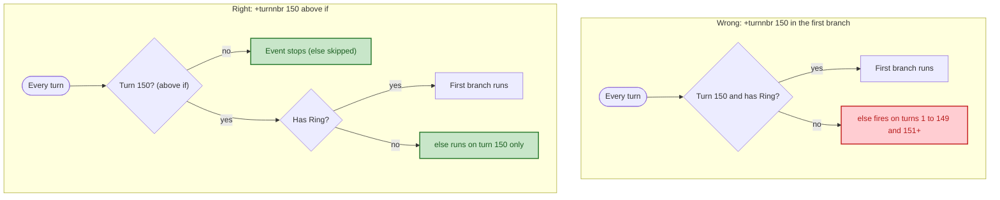
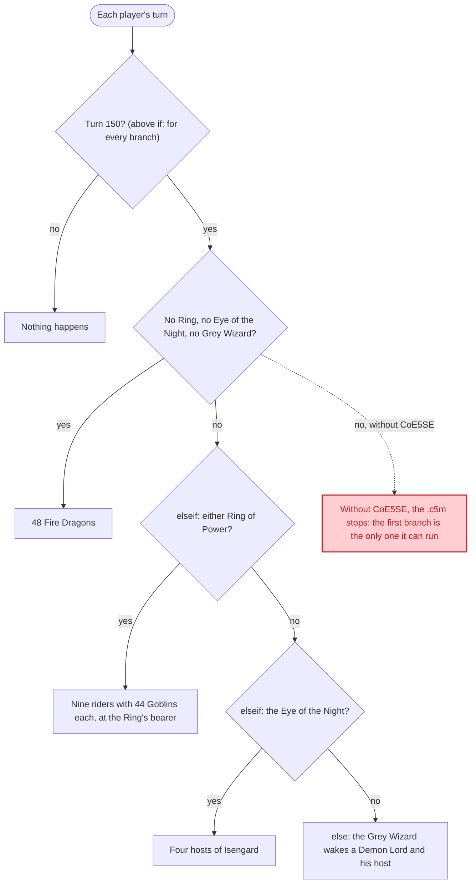

<!-- Generated by scripts/gen_docs_commands.py in the CoE5SE sources from docs/commands-page/events.md. Edit it there, not here. -->

# Event Logic

Give your events if-then logic, so a single event can have multiple decision trees or checks within the game.

Each word is declared alone on a line inside a `playerevent` or `squareevent`. To gate an event on a mod setting, use [`+setting`](mod-settings.md#setting). To count corpses of one type, use [`+mincorpses`](corpses.md#mincorpses).

!!! info "More in the CoE5 manual"
    Vanilla event triggers and actions are in Illwinter's official modding manual, under ["Events"](https://www.illwinter.com/coe5/coe5modding.pdf#page=38).

## How branching works { #how-an-event-runs }

CoE5 checks a `playerevent` once for each player every turn. A `+` trigger must be true, a `-` trigger must be false, and `-2` refers to the active player.

CoE5SE evaluates branches from top to bottom inside an event:

- Triggers placed above `if` act as shared preconditions for every branch. If they fail, the entire event stops (including `else`). In a `squareevent`, every branch starts from the squares kept by the triggers above `if`.
- Each branch (`if`, `elseif`, `else`) runs only if no earlier branch matched. Once a branch's actions run, the rest of the event is skipped.
- Inside any branch (or above `if`), `or` splits triggers into alternative groups. The section passes if every trigger in at least one group passes.

## Branching commands

### if { #if .command data-toc-label="if" data-added="2.8" }

Starts the branches of an event. Triggers placed above `if` must pass before any branch is tested. If they fail, no branch runs, `else` included.

Declare at most one `if` per event, before any actions (`setvar`, `message`, and the rest) and before any `elseif` or `else`. Putting an action above `if` runs that action and then stops the rest of the event. Declaring a second `if` also stops the rest of the event.

=== ".c5m"

    Shared trigger required by every branch:

    ```c5m
    +turnnbr 150
    #!@if
    ```

=== ".c5se"

    Shared trigger required by every branch:

    ```c5se
    +turnnbr 150
    if
    ```

### or { #or .command data-toc-label="or" data-added="2.4" }

Starts an alternative group of triggers. The section passes if every trigger in any one group passes. Declare `or` between triggers, before the branch's first action (or above `if`).

In a `playerevent`, the first group that passes locks in the event's target square and unit. Later `or` groups are skipped, so a `+hasunithere` in a later group never overwrites the target. In a `squareevent`, `or` keeps every square that passed any group.

=== ".c5m"

    Either of two items:

    ```c5m
    +hasitem -2 "Ring of Invisibility"
    #!@or
    +hasitem -2 "Ring of Shadows"
    ```

=== ".c5se"

    Either of two items:

    ```c5se
    +hasitem -2 "Ring of Invisibility"
    or
    +hasitem -2 "Ring of Shadows"
    ```

### elseif { #elseif .command data-toc-label="elseif" data-added="2.4" }

Starts the next branch, with triggers followed by actions. Runs only if no earlier branch ran.

=== ".c5m"

    Or the player holds another item:

    ```c5m
    #!@elseif
    +hasitem -2 "Eye of the Night"
    ```

=== ".c5se"

    Or the player holds another item:

    ```c5se
    elseif
    +hasitem -2 "Eye of the Night"
    ```

### else { #else .command data-toc-label="else" data-added="2.4" }

Starts the fallback branch, with no triggers. Its actions run whenever no earlier branch matched.

Put only actions after `else`. Putting another `elseif` or `else` after `else` stops the rest of the event. If your event should only fire once, read [Using else in one-time events](#one-time-else) before adding `else`.

=== ".c5m"

    Otherwise:

    ```c5m
    #!@else
    message -2 "A Demon Lord and his host climb out of the dark."
    newunits 28 "c*Demon Lord & 6*Greater Demon & 60*Lesser Demon"
    ```

=== ".c5se"

    Otherwise:

    ```c5se
    else
    message -2 "A Demon Lord and his host climb out of the dark."
    newunits 28 "c*Demon Lord & 6*Greater Demon & 60*Lesser Demon"
    ```

## Using else in one-time events { #one-time-else }

CoE5 checks a `playerevent` every turn for every player. Without a trigger above `if`, `else` runs on every turn where the earlier branches fail.

To stop `else` from firing every turn, put the trigger that gates the whole event (such as `+turnnbr 150` or `+varequal`) **above `if`**. When a trigger above `if` fails, the entire event stops and `else` is skipped.



=== ".c5m"

    Wrong: +turnnbr 150 is in the first branch, so else runs on every other turn:

    ```c5m
    playerevent
    +turnnbr 150
    +hasitem -2 "Ring of Invisibility"
    message -2 "The Ring answers the call."
    #!@else
    message -2 "The Shadow falls."
    endevent
    ```

    Right: +turnnbr 150 sits above if, so else runs on turn 150 only:

    ```c5m
    playerevent
    +turnnbr 150
    #!@if
    +hasitem -2 "Ring of Invisibility"
    message -2 "The Ring answers the call."
    #!@else
    message -2 "The Shadow falls."
    endevent
    ```

=== ".c5se"

    Wrong: +turnnbr 150 is in the first branch, so else runs on every other turn:

    ```c5se
    playerevent
    +turnnbr 150
    +hasitem -2 "Ring of Invisibility"
    message -2 "The Ring answers the call."
    else
    message -2 "The Shadow falls."
    endevent
    ```

    Right: +turnnbr 150 sits above if, so else runs on turn 150 only:

    ```c5se
    playerevent
    +turnnbr 150
    if
    +hasitem -2 "Ring of Invisibility"
    message -2 "The Ring answers the call."
    else
    message -2 "The Shadow falls."
    endevent
    ```

## Square events and vanilla fallback

!!! note "In a `squareevent`"
    Each square is branched independently. A square runs the actions of the first branch whose triggers match it and skips later branches, so `else` catches every square that did not match any earlier branch. With `or`, a square passes if it matches any trigger group.

!!! tip "For players without CoE5SE"
    Put the default branch first, and start each later branch with a trigger the first branch rules out. In a `.c5m`, vanilla CoE5 ignores `#!@` lines and reads straight down, stopping at the first trigger that fails. That way it runs the first branch cleanly and skips the rest.

## Example event { #example }

=== ".c5m"

    ```c5m
    playerevent
    +turnnbr 150
    #!@if
    -hasitem -2 "Ring of Invisibility"
    -hasitem -2 "Ring of Shadows"
    -hasitem -2 "Eye of the Night"
    -hasunit -2 "Grey Wizard"
    message -2 "The fate of the Ring looks bleak. No ring, no stone, no wizard to stand with you, and 48 dragons come down from the north."
    scatterloc 5
    newunits 28 "c*Fire Dragon & 47*Fire Dragon"
    #!@elseif
    +hasitem -2 "Ring of Invisibility"
    #!@or
    +hasitem -2 "Ring of Shadows"
    message -2 "You kept a Ring of Power. Nine riders and 400 orcs cross the river to take it back."
    targetunitloc
    scatterloc 3
    newunits 28 "c*Ebon Knight & 44*Goblin"
    newunits 28 "c*Ebon Knight & 44*Goblin"
    newunits 28 "c*Ebon Knight & 44*Goblin"
    newunits 28 "c*Ebon Knight & 44*Goblin"
    newunits 28 "c*Ebon Knight & 44*Goblin"
    newunits 28 "c*Ebon Knight & 44*Goblin"
    newunits 28 "c*Ebon Knight & 44*Goblin"
    newunits 28 "c*Ebon Knight & 44*Goblin"
    newunits 28 "c*Ebon Knight & 44*Goblin"
    #!@elseif
    +hasitem -2 "Eye of the Night"
    message -2 "Saruman sees you through the stone. Four hosts of Isengard, 280 strong, march on your citadel."
    scatterloc 4
    newunits 28 "c*Goblin Chieftain & 60*Goblin Archer & 10*Troll"
    newunits 28 "c*Goblin Chieftain & 60*Goblin Archer & 10*Troll"
    newunits 28 "c*Goblin Chieftain & 60*Goblin Archer & 10*Troll"
    newunits 28 "c*Goblin Chieftain & 60*Goblin Archer & 10*Troll"
    #!@else
    message -2 "Gandalf's light wakes something deep below. A Demon Lord and his host climb out of the dark."
    scatterloc 2
    newunits 28 "c*Demon Lord & 6*Greater Demon & 60*Lesser Demon"
    endevent
    ```

=== ".c5se"

    ```c5se
    playerevent
    +turnnbr 150
    if
    -hasitem -2 "Ring of Invisibility"
    -hasitem -2 "Ring of Shadows"
    -hasitem -2 "Eye of the Night"
    -hasunit -2 "Grey Wizard"
    message -2 "The fate of the Ring looks bleak. No ring, no stone, no wizard to stand with you, and 48 dragons come down from the north."
    scatterloc 5
    newunits 28 "c*Fire Dragon & 47*Fire Dragon"
    elseif
    +hasitem -2 "Ring of Invisibility"
    or
    +hasitem -2 "Ring of Shadows"
    message -2 "You kept a Ring of Power. Nine riders and 400 orcs cross the river to take it back."
    targetunitloc
    scatterloc 3
    newunits 28 "c*Ebon Knight & 44*Goblin"
    newunits 28 "c*Ebon Knight & 44*Goblin"
    newunits 28 "c*Ebon Knight & 44*Goblin"
    newunits 28 "c*Ebon Knight & 44*Goblin"
    newunits 28 "c*Ebon Knight & 44*Goblin"
    newunits 28 "c*Ebon Knight & 44*Goblin"
    newunits 28 "c*Ebon Knight & 44*Goblin"
    newunits 28 "c*Ebon Knight & 44*Goblin"
    newunits 28 "c*Ebon Knight & 44*Goblin"
    elseif
    +hasitem -2 "Eye of the Night"
    message -2 "Saruman sees you through the stone. Four hosts of Isengard, 280 strong, march on your citadel."
    scatterloc 4
    newunits 28 "c*Goblin Chieftain & 60*Goblin Archer & 10*Troll"
    newunits 28 "c*Goblin Chieftain & 60*Goblin Archer & 10*Troll"
    newunits 28 "c*Goblin Chieftain & 60*Goblin Archer & 10*Troll"
    newunits 28 "c*Goblin Chieftain & 60*Goblin Archer & 10*Troll"
    else
    message -2 "Gandalf's light wakes something deep below. A Demon Lord and his host climb out of the dark."
    scatterloc 2
    newunits 28 "c*Demon Lord & 6*Greater Demon & 60*Lesser Demon"
    endevent
    ```

### Example breakdown { #example-breakdown }

This event triggers once on turn 150. Because `+turnnbr 150` sits above `if`, it gates every branch (including `else`) while only being written once.

- **Vanilla fallback:** The first branch runs when a player has none of the items or the Grey Wizard. Without CoE5SE, the game skips `#!@` lines, reads straight down, and stops at the first failing trigger (shown in red below).
- **Top-to-bottom priority:** Earlier branches win. A player holding both a Ring and the Eye of the Night gets the riders, not Isengard.
- **Fallback branch:** `else` handles the remaining case where the player kept the Grey Wizard.
- **Targets:** Every army spawns for Inferno (player 28). `targetunitloc` sends the riders to the Ring's bearer, while the other armies arrive near the player's home using `scatterloc`.


