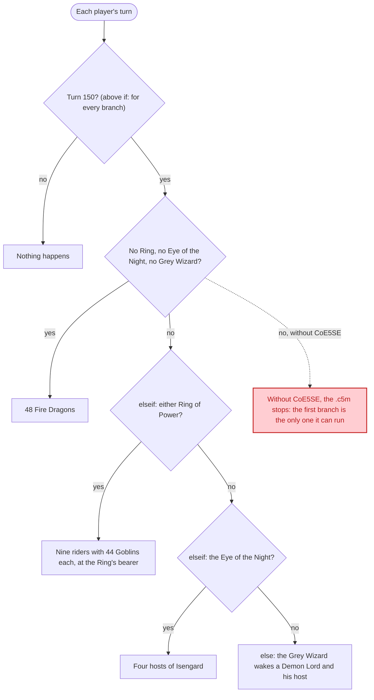

<!-- Generated by scripts/gen_docs_commands.py in the CoE5SE sources from docs/commands-page/events.md. Edit it there, not here. -->

# Events

Give your events if-then logic, so a single event can react to each situation in its own way.

Each word stands alone on its line, inside a `playerevent` or `squareevent`.

!!! info "More in the game's manual"
    The game's own event triggers and actions are in Illwinter's official modding manual, under ["Events"](https://www.illwinter.com/coe5/coe5modding.pdf#page=38).

### How an event runs { #how-an-event-runs }

- `playerevent` starts an event and `endevent` ends it. The game checks a `playerevent` once for each player, every turn.
- A `+` trigger must be true and a `-` trigger must be false. `-2` is the player whose turn it is.
- `if` starts the branches. The triggers above it hold for every branch, so a condition the whole event needs, like the turn, is written once.
- `elseif` starts the next branch, which is tried only if no branch above it ran. `else` is the last branch, and it runs if nothing above it did.
- `or` splits one branch's triggers into groups. The branch holds if every trigger in any one group holds.
- The game tries the branches from the top. The first branch whose triggers hold runs its actions, and the rest of the event is skipped, so one branch runs for each player each turn.

### if <span class="new-badge">New</span> { #if data-toc-label="if" }

Starts the branches. The triggers above it hold for every branch below it: when they hold, each branch starts from there; when they fail, no branch runs, `else` included. At most one `if`, before the first branch's actions.

=== ".c5se"

    A trigger every branch needs:

    ```c5se
    +turnnbr 150
    if
    ```

=== ".c5m"

    A trigger every branch needs:

    ```c5m
    +turnnbr 150
    #!@if
    ```

### or { #or data-toc-label="or" }

Starts another group of triggers. The event holds when every trigger in any one group holds. It goes between triggers, before the branch's first action. In a `playerevent`, the first group that holds sets the event's target: a `+hasunithere` in a later group doesn't change it.

=== ".c5se"

    Either of two items:

    ```c5se
    +hasitem -2 "Ring of Invisibility"
    or
    +hasitem -2 "Ring of Shadows"
    ```

=== ".c5m"

    Either of two items:

    ```c5m
    +hasitem -2 "Ring of Invisibility"
    #!@or
    +hasitem -2 "Ring of Shadows"
    ```

### elseif { #elseif data-toc-label="elseif" }

Starts another branch: its own triggers, then its own actions. It runs only if no branch before it ran.

=== ".c5se"

    Or the player holds another item:

    ```c5se
    elseif
    +hasitem -2 "Eye of the Night"
    ```

=== ".c5m"

    Or the player holds another item:

    ```c5m
    #!@elseif
    +hasitem -2 "Eye of the Night"
    ```

### else { #else data-toc-label="else" }

Starts the last branch, with no triggers: its actions run whenever no branch before it ran, on every turn the event checks. Use it in an event meant to act every turn, not in a one-time event. Put only its actions after it: another `elseif` or `else` after it stops the rest of the event.

=== ".c5se"

    Otherwise:

    ```c5se
    else
    message -2 "A Demon Lord and his host climb out of the dark."
    newunits 28 "c*Demon Lord & 6*Greater Demon & 60*Lesser Demon"
    ```

=== ".c5m"

    Otherwise:

    ```c5m
    #!@else
    message -2 "A Demon Lord and his host climb out of the dark."
    newunits 28 "c*Demon Lord & 6*Greater Demon & 60*Lesser Demon"
    ```

!!! tip "For players without CoE5SE"
    Put the branch every player can get first, and start each later branch with a trigger the first one rules out. In the .c5m, the game without CoE5SE skips these words and reads the rest straight through. It stops at the first trigger that fails, so it runs the first branch and nothing else.

!!! note "In a squareevent"
    Each square takes its own branch, and `or` keeps every square that any group kept. With a terrain trigger, then `else`, the actions before `else` run on that terrain's squares and the ones after it on every other square.

### Example event { #example }

=== ".c5se"

    ```c5se
    playerevent
    +turnnbr 150
    if
    -hasitem -2 "Ring of Invisibility"
    -hasitem -2 "Ring of Shadows"
    -hasitem -2 "Eye of the Night"
    -hasunit -2 "Grey Wizard"
    message -2 "The fate of the Ring looks bleak. No ring, no stone, no wizard to stand with you, and 48 dragons come down from the north."
    scatterloc 5
    newunits 28 "c*Fire Dragon & 47*Fire Dragon"
    elseif
    +hasitem -2 "Ring of Invisibility"
    or
    +hasitem -2 "Ring of Shadows"
    message -2 "You kept a Ring of Power. Nine riders and 400 orcs cross the river to take it back."
    targetunitloc
    scatterloc 3
    newunits 28 "c*Ebon Knight & 44*Goblin"
    newunits 28 "c*Ebon Knight & 44*Goblin"
    newunits 28 "c*Ebon Knight & 44*Goblin"
    newunits 28 "c*Ebon Knight & 44*Goblin"
    newunits 28 "c*Ebon Knight & 44*Goblin"
    newunits 28 "c*Ebon Knight & 44*Goblin"
    newunits 28 "c*Ebon Knight & 44*Goblin"
    newunits 28 "c*Ebon Knight & 44*Goblin"
    newunits 28 "c*Ebon Knight & 44*Goblin"
    elseif
    +hasitem -2 "Eye of the Night"
    message -2 "Saruman sees you through the stone. Four hosts of Isengard, 280 strong, march on your citadel."
    scatterloc 4
    newunits 28 "c*Goblin Chieftain & 60*Goblin Archer & 10*Troll"
    newunits 28 "c*Goblin Chieftain & 60*Goblin Archer & 10*Troll"
    newunits 28 "c*Goblin Chieftain & 60*Goblin Archer & 10*Troll"
    newunits 28 "c*Goblin Chieftain & 60*Goblin Archer & 10*Troll"
    else
    message -2 "Gandalf's light wakes something deep below. A Demon Lord and his host climb out of the dark."
    scatterloc 2
    newunits 28 "c*Demon Lord & 6*Greater Demon & 60*Lesser Demon"
    endevent
    ```

=== ".c5m"

    ```c5m
    playerevent
    +turnnbr 150
    #!@if
    -hasitem -2 "Ring of Invisibility"
    -hasitem -2 "Ring of Shadows"
    -hasitem -2 "Eye of the Night"
    -hasunit -2 "Grey Wizard"
    message -2 "The fate of the Ring looks bleak. No ring, no stone, no wizard to stand with you, and 48 dragons come down from the north."
    scatterloc 5
    newunits 28 "c*Fire Dragon & 47*Fire Dragon"
    #!@elseif
    +hasitem -2 "Ring of Invisibility"
    #!@or
    +hasitem -2 "Ring of Shadows"
    message -2 "You kept a Ring of Power. Nine riders and 400 orcs cross the river to take it back."
    targetunitloc
    scatterloc 3
    newunits 28 "c*Ebon Knight & 44*Goblin"
    newunits 28 "c*Ebon Knight & 44*Goblin"
    newunits 28 "c*Ebon Knight & 44*Goblin"
    newunits 28 "c*Ebon Knight & 44*Goblin"
    newunits 28 "c*Ebon Knight & 44*Goblin"
    newunits 28 "c*Ebon Knight & 44*Goblin"
    newunits 28 "c*Ebon Knight & 44*Goblin"
    newunits 28 "c*Ebon Knight & 44*Goblin"
    newunits 28 "c*Ebon Knight & 44*Goblin"
    #!@elseif
    +hasitem -2 "Eye of the Night"
    message -2 "Saruman sees you through the stone. Four hosts of Isengard, 280 strong, march on your citadel."
    scatterloc 4
    newunits 28 "c*Goblin Chieftain & 60*Goblin Archer & 10*Troll"
    newunits 28 "c*Goblin Chieftain & 60*Goblin Archer & 10*Troll"
    newunits 28 "c*Goblin Chieftain & 60*Goblin Archer & 10*Troll"
    newunits 28 "c*Goblin Chieftain & 60*Goblin Archer & 10*Troll"
    #!@else
    message -2 "Gandalf's light wakes something deep below. A Demon Lord and his host climb out of the dark."
    scatterloc 2
    newunits 28 "c*Demon Lord & 6*Greater Demon & 60*Lesser Demon"
    endevent
    ```

### Example breakdown { #example-breakdown }

One event that acts once, on turn 150. `+turnnbr 150` sits above `if`, so it holds for every branch and is written once. Without CoE5SE the event can do one thing: the dragons, for a player who gathered nothing. With CoE5SE, what comes depends on what the player gathered. The game tries the branches from the top, in the order the chart below shows.

- The first branch is the one a game without CoE5SE can run. It reads the .c5m straight down, skipping the `#!@` lines, and stops at the first trigger that fails: the red box.
- Earlier branches win. A player with a Ring and the Eye of the Night gets the riders, not Isengard.
- `else` is the only case left: the player kept the Grey Wizard.
- Every army belongs to the Inferno, player 28. `targetunitloc` sends the riders to the Ring's bearer; the other armies arrive near the player's home, spread out by `scatterloc`.


