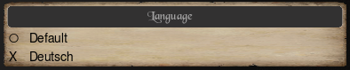
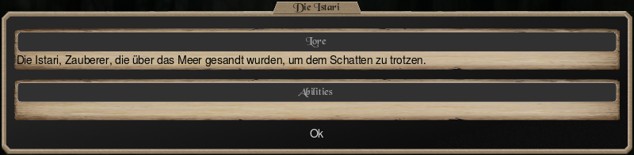
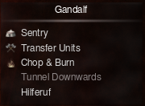
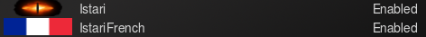
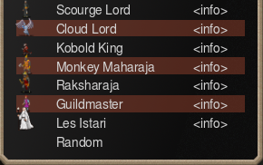
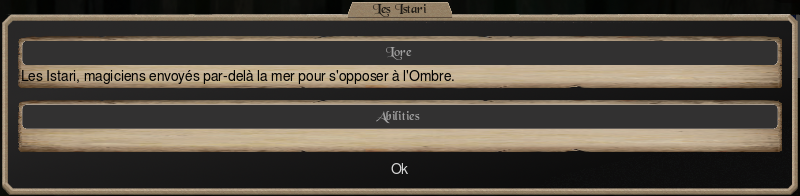
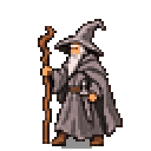

<!-- Generated by scripts/gen_docs_commands.py in the CoE5SE sources from docs/commands-page/languages.md. Edit it there, not here. -->

# Languages

Translate your mod, or someone else's, into other languages: its names, descriptions, settings and script text. A player picks a language on CoE5SE's page in Mod Settings, and every enabled mod shows its text in that language. A translation mod that holds a single language needs no pick: it applies as soon as a player enables it. Greek, Cyrillic and accented letters draw from the game's own fonts. Chinese, Japanese, Korean, Thai and other letters the game's fonts lack draw from a font your mod adds with [`fallbackfont`](#fallbackfont). [Limits](limits.md#languages) has how many languages and fonts mods can add.

!!! info "More in the game's manual"
    `translation` and `fontfile` are in Illwinter's official modding manual, under ["Fonts & Translation"](https://www.illwinter.com/coe5/coe5modding.pdf#page=4).

This page walks through two translations of the Istari mod from [Getting Started](../getting-started.md): its author adds German, then another modder adds French.

## Add a language to your mod { #your-mod }

### 1. Dump text to a file { #your-mod-text }

Start the game with the `--dumpstrings` start option (in Steam: the game's Properties, then Launch Options) and your mod enabled. Beside your mods directory, CoE5SE writes `coe5se_translations/Istari.c5se`: every text of your mod as a `translation` line to fill in.

```c5se title="coe5se_translations/Istari.c5se"
# CoE5SE: translation template for Istari
# Every text CoE5SE read from the mod's files, once each. A filled line is the translation the game shows now.
# A line starting with # is not translated yet: the translation goes in its second quotes, then the # comes off.
# The lines go in a .c5se of a mod, under the language line. Written again at each mods pass: copy before editing.
# No language picked on CoE5SE's page in Mod Settings. The block starts with a language tag and the language's own name:
# language "fr" "Français"

# Istari.c5m
# translation "Adds The Istari, a class of wizards with Gandalf among them." ""
# translation "Istar" ""
# translation "Grey Wizard" ""
# translation "Dunedain Ranger" ""
# translation "Rohirrim Rider" ""
# translation "The Istari" ""
# translation "The Istari, wizards sent across the sea to stand against the Shadow." ""

# Istari.lua
# translation "Call for Aid" ""
# translation "Once per game. Dunedain Rangers or Rohirrim Riders join Gandalf." ""
# translation "Cancel" ""
```

### 2. Fill the file { #your-mod-fill }

Copy the file into your mod's folder as `lang/de.c5se`. Start it with a [`language`](#language) line, write each translation in the second quotes, and take the `#` off the line.

```c5se title="Istari/lang/de.c5se"
language "de" "Deutsch"

# Istari.c5m
translation "Adds The Istari, a class of wizards with Gandalf among them." "Fügt die Istari hinzu, eine Klasse von Zauberern, darunter Gandalf."
translation "Istar" "Istar"
translation "Grey Wizard" "Grauer Zauberer"
translation "Dunedain Ranger" "Dúnedain-Waldläufer"
translation "Rohirrim Rider" "Reiter der Rohirrim"
translation "The Istari" "Die Istari"
translation "The Istari, wizards sent across the sea to stand against the Shadow." "Die Istari, Zauberer, die über das Meer gesandt wurden, um dem Schatten zu trotzen."

# Istari.lua
translation "Call for Aid" "Hilferuf"
translation "Once per game. Dunedain Rangers or Rohirrim Riders join Gandalf." "Einmal pro Spiel. Dúnedain-Waldläufer oder Reiter der Rohirrim schließen sich Gandalf an."
translation "Cancel" "Abbrechen"
translation "The Dunedain" "Die Dúnedain" # (1)!
translation "6 Dunedain Rangers" "6 Dúnedain-Waldläufer"
translation "The Rohirrim" "Die Rohirrim"
translation "4 Rohirrim Riders" "4 Reiter der Rohirrim"
```

1.  The last four lines were added by hand. Istari.lua keeps these texts in a table, and the template lists only text written inside a `coe5` call.

### 3. Include the file { #your-mod-include }

Add an [`include`](other-commands.md#include) line to your mod. Each language can have a file of its own.

```c5m title="Istari/Istari.c5m"
#!@include "lang/de.c5se"
```

### 4. Pick the language { #your-mod-pick }

Start the game again. Language, on CoE5SE's page in Mod Settings, lists every language an enabled mod has. Pick Deutsch and leave the page.

<div class="coe5se-shots" markdown>
<figure markdown>

<figcaption>Deutsch, picked in Mod Settings</figcaption>
</figure>
<figure markdown>

<figcaption>The class, in Choose Class</figcaption>
</figure>
</div>

<div class="coe5se-shots" markdown>
<figure markdown>

<figcaption>The class's description</figcaption>
</figure>
</div>

<div class="coe5se-shots" markdown>
<figure markdown>

<figcaption>Gandalf's orders</figcaption>
</figure>
<figure markdown>

<figcaption>The script's screen</figcaption>
</figure>
</div>

A `translation` line changes its text everywhere the game shows it. With this file, every Cancel button in the game reads Abbrechen.

### 5. Check it { #your-mod-check }

With `--dumpstrings` still set, leaving the page with a new pick wrote `coe5se_translations/report.txt`, for German. It counts each mod's translated and missing lines. The Istari mod's part:

```text title="coe5se_translations/report.txt"
== Istari: 10 texts, 10 translated, 0 missing ==
Not in any enabled mod: "The Dunedain" (lang/de.c5se line 16)
Not in any enabled mod: "6 Dunedain Rangers" (lang/de.c5se line 17)
Not in any enabled mod: "The Rohirrim" (lang/de.c5se line 18)
Not in any enabled mod: "4 Rohirrim Riders" (lang/de.c5se line 19)
```

The four lines added by hand are listed because the template never had their text. They translate all the same, as the script's screen shows.

## Translate someone else's mod { #another-mod }

Here another modder adds French to the Istari mod with a small mod of their own, and the Istari mod's files stay as they are.

### 1. Make your mod { #another-mod-make }

In your mods directory (Open Mods Directory, on the Mods screen), make a folder with a .c5m and a .c5se of the same name. The .c5m holds the mod's banner, a 256x64 .tga or .png in the same folder, and its description.

```c5m title="IstariFrench/IstariFrench.c5m"
icon "banner.png"
description "The Istari mod in French."
```

### 2. Get the mod's text { #another-mod-text }

Start the game with `--dumpstrings` and the Istari mod enabled, as in [step 1 above](#your-mod-text). Copy the lines of `coe5se_translations/Istari.c5se` into your .c5se under a `language` line, and fill them in.

```c5se title="IstariFrench/IstariFrench.c5se"
personalmod # (1)!

language "fr" "Français"
description "Le mod Istari en français." # (2)!

# Istari.c5m
translation "Adds The Istari, a class of wizards with Gandalf among them." "Ajoute les Istari, une classe de magiciens, dont Gandalf."
translation "Istar" "Istar"
translation "Grey Wizard" "Magicien gris"
translation "Dunedain Ranger" "Rôdeur dúnadan"
translation "Rohirrim Rider" "Cavalier du Rohan"
translation "The Istari" "Les Istari"
translation "The Istari, wizards sent across the sea to stand against the Shadow." "Les Istari, magiciens envoyés par-delà la mer pour s'opposer à l'Ombre."

# Istari.lua
translation "Call for Aid" "Appel à l'aide"
# translation "Once per game. Dunedain Rangers or Rohirrim Riders join Gandalf." ""
translation "Cancel" "Annuler"
```

1.  With [`personalmod`](mod-loading.md#personalmod), each player in a LAN game may have their own translation mod, or none.
2.  IstariFrench's description, in French.

### 3. Enable both mods { #another-mod-enable }

IstariFrench is a [one-language translation mod](#language): with Language at Default, it applies as soon as you enable it.

<div class="coe5se-shots" markdown>
<figure markdown>

<figcaption>Both mods, on the Mods screen</figcaption>
</figure>
</div>

<div class="coe5se-shots" markdown>
<figure markdown>

<figcaption>The class, in Choose Class</figcaption>
</figure>
<figure markdown>

<figcaption>The class's description</figcaption>
</figure>
</div>

### 4. See what is left { #another-mod-check }

The report is for French. It lists the line still to translate, and after the Istari mod updates, each new text and each line whose text the mod no longer has. Text a script keeps in a table is in neither the template nor the report, so add its lines by hand, as for German.

```text title="coe5se_translations/report.txt"
== Istari: 10 texts, 9 translated, 1 missing ==
Missing: "Once per game. Dunedain Rangers or Rohirrim Riders join Gandalf." (Istari.lua line 16)
```

## The commands { #commands }

### language "&lt;tag&gt;" ["&lt;name&gt;"] <span class="new-badge">New</span> { #language .command data-toc-label="language" data-added="3.6" }

Starts the lines for one language. They apply while a player has that language picked in Mod Settings, and end at the next `language` line. A mod that only translates into one language needs no pick: its lines apply with Default too.

- **tag:** The language's code: `de`, `fr`, `pt-BR`, `zh-Hans`. Capitals don't matter. A text with no `pt-BR` line shows its `pt` line.
- **name:** The language's name in Mod Settings, written in that language: "Deutsch", "日本語". Without one, the tag shows.

Only the lines in [What a block holds](#block) go under it. A text with no translation shows as written. <!-- vale CoE5SE.Reports = NO -->Any other line does nothing (logged in `coe5mod.log`).<!-- vale CoE5SE.Reports = YES -->

=== ".c5m"

    ```c5m
    #!@language "de" "Deutsch"
    translation "Hobbit Archer" "Hobbit-Bogenschütze"
    ```

=== ".c5se"

    ```c5se
    language "de" "Deutsch"
    translation "Hobbit Archer" "Hobbit-Bogenschütze"
    ```

### fallbackfont "&lt;file&gt;" ["&lt;tag&gt;"] <span class="new-badge">New</span> { #fallbackfont .command data-toc-label="fallbackfont" data-added="3.6" }

Adds a font for letters the game's fonts lack, such as Chinese, Japanese, Korean, Thai or emoji. Unlike vanilla `fontfile`, it replaces none of the game's fonts. Under a `language` line, it applies only with that language.

- **file:** A .ttf or .otf file, its path from your .c5m's folder, as `include` takes it. Letters, digits, `_`, `-`, `.` and `/` only.
- **tag:** The language the font is for. With that language picked, this font is tried first, so Japanese draws its kanji from a Japanese font even with a Chinese font enabled.

Greek, Cyrillic and the accented letters of Western and Central European languages need no `fallbackfont`: the game's fonts have them.

=== ".c5m"

    ```c5m
    #!@fallbackfont "NotoSansJP-Regular.otf" "ja"
    ```

=== ".c5se"

    ```c5se
    fallbackfont "NotoSansJP-Regular.otf" "ja"
    ```

## What a block holds { #block }

| Line | In a block |
| --- | --- |
| `translation "from" "to"` | As in vanilla, for that language. A `^` in either text is a line break, for a text of more than one paragraph. A `#` between the quotes is part of the text. |
| `fontfile`, `fallbackfont` | As outside a block, for that language. |
| `description "text"` | Your mod's description on the Mods screen. With that language picked, also while the mod is disabled. |
| `selectmonster`, `selectitem`, `selectritual` or `selectaffliction`, then `descr "text"` | The description of that monster, item, ritual or affliction, found by its name. |
| `selectclass`, then `classdescr`, `classabdescr`, `libbonusdescr`, `townbonusdescr` or `templebonusdescr` | That class's text. |

These lines work whatever the load order, so a translation mod may load before the mod it translates. A translation mod can also be a plain .c5m whose first line is `#!@language`, which the game without CoE5SE reads as a comment. A mod whose only lines are in language blocks adds no content, so with `personalmod` each player in a LAN game may have their own.

Text a Lua script shows translates the same way, and `coe5.translate` gives a script the translation of the text it formats itself.

## The --dumpstrings files { #translators }

With the `--dumpstrings` start option, CoE5SE writes these beside your mods directory, along with the game's `transtrings.txt`:

- `coe5se_translations/<mod>.c5se`: every text of each enabled mod, as `translation` lines to fill in, under a `language` line for the picked language.
- `coe5se_translations/report.txt`: for that language, each mod's translated and missing lines, and the lines whose text the mod no longer has. It also lists lines the game ignores because their `%` codes differ, and letters no font has.

### Example { #example }

=== ".c5m"

    ```c5m
    #!@include "lang/de.c5se"
    ```

=== ".c5se"

    ```c5se
    include "lang/de.c5se"
    ```

```c5se title="lang/de.c5se"
language "de" "Deutsch"
description "Die Zauberer, Reiche und Völker Mittelerdes. Braucht CoE5SE."
translation "The Eye of Sauron awakens" "Das Auge Saurons erwacht"
translation "Never" "Nie"
translation "Endgame scenarios" "Endspiel-Szenarien"
translation "Hobbit Archer" "Hobbit-Bogenschütze"
translation "Ranger of the North" "Waldläufer des Nordens"
selectritual "Muster of the Dead"
descr "Der Hexenkönig ruft ein bemessenes Heer."
```

## The finished mods { #finished }

<div class="mod-explorer" markdown>
<div class="mod-explorer__layouts">
<button class="mod-explorer__layout" data-layout="own" type="button">Istari in German</button>
<button class="mod-explorer__layout" data-layout="other" type="button">IstariFrench</button>
</div>
<p class="mod-explorer__caption" data-layout="own">The Istari mod after <a href="#your-mod">Add a language to your mod</a>: German in <code>lang/de.c5se</code>, which Istari.c5m includes.</p>
<p class="mod-explorer__caption" data-layout="other">The mods directory after <a href="#another-mod">Translate someone else's mod</a>: IstariFrench beside the Istari mod, whose files stay as they are.</p>
<div class="mod-explorer__tree">
<div class="mod-explorer__files" data-layout="own">
<span class="mod-explorer__folder">Istari/</span>
<button class="mod-explorer__file" data-file="de-c5m" type="button">Istari.c5m</button>
<button class="mod-explorer__file" data-file="lua" type="button">Istari.lua</button>
<button class="mod-explorer__file" data-file="white" type="button">istar.tga</button>
<button class="mod-explorer__file" data-file="grey" type="button">greywizard.tga</button>
<button class="mod-explorer__file" data-file="banner" type="button">banner.png</button>
<span class="mod-explorer__folder mod-explorer__folder--nested">lang/</span>
<button class="mod-explorer__file mod-explorer__file--nested" data-file="de-c5se" type="button">de.c5se</button>
</div>
<div class="mod-explorer__files" data-layout="other">
<span class="mod-explorer__folder">IstariFrench/</span>
<button class="mod-explorer__file" data-file="fr-c5m" type="button">IstariFrench.c5m</button>
<button class="mod-explorer__file" data-file="fr-c5se" type="button">IstariFrench.c5se</button>
<button class="mod-explorer__file" data-file="fr-banner" type="button">banner.png</button>
<span class="mod-explorer__folder">Istari/</span>
<button class="mod-explorer__file" data-file="c5m" type="button">Istari.c5m</button>
<button class="mod-explorer__file" data-file="lua" type="button">Istari.lua</button>
<button class="mod-explorer__file" data-file="white" type="button">istar.tga</button>
<button class="mod-explorer__file" data-file="grey" type="button">greywizard.tga</button>
<button class="mod-explorer__file" data-file="banner" type="button">banner.png</button>
</div>
</div>
<div class="mod-explorer__pane" data-file="de-c5m" markdown>

```c5m title="Istari/Istari.c5m"
icon "banner.png"
description "Adds The Istari, a class of wizards with Gandalf among them."

newmonster "Istar"
copystats "White Wizard"
spr1 "istar.tga"

newmonster "Grey Wizard"
copystats "Pyromancer"
spr1 "greywizard.tga"
#!@fixedname "Gandalf" # (1)!

newmonster "Dunedain Ranger" # (2)!
copystats "Longbowman"

newmonster "Rohirrim Rider"
copystats "Knight"

newclass
setclassname "The Istari"
classdescr "The Istari, wizards sent across the sea to stand against the Shadow."
hometerr 156 # (3)!
setmaincom "Istar" # (4)!
addstartcom "Grey Wizard"
addstartunits "Spearman" 10
addstartunits "Archer" 5
stdtroops
#!@include "lang/de.c5se" # (5)!
```

1.  `#!@` makes this a line only CoE5SE reads: [The .c5m and the .c5se](../index.md#files).
2.  One of the two units Istari.lua puts on Gandalf's square when he calls for aid.
3.  156 is the Crystal Palace, the class's home citadel.
4.  The main commander's sprite, istar.tga, is the class's picture in Choose Class.
5.  The German file, from [step 3](#your-mod-include).

</div>
<div class="mod-explorer__pane" data-file="de-c5se" markdown>

```c5se title="Istari/lang/de.c5se"
language "de" "Deutsch"

# Istari.c5m
translation "Adds The Istari, a class of wizards with Gandalf among them." "Fügt die Istari hinzu, eine Klasse von Zauberern, darunter Gandalf."
translation "Istar" "Istar"
translation "Grey Wizard" "Grauer Zauberer"
translation "Dunedain Ranger" "Dúnedain-Waldläufer"
translation "Rohirrim Rider" "Reiter der Rohirrim"
translation "The Istari" "Die Istari"
translation "The Istari, wizards sent across the sea to stand against the Shadow." "Die Istari, Zauberer, die über das Meer gesandt wurden, um dem Schatten zu trotzen."

# Istari.lua
translation "Call for Aid" "Hilferuf"
translation "Once per game. Dunedain Rangers or Rohirrim Riders join Gandalf." "Einmal pro Spiel. Dúnedain-Waldläufer oder Reiter der Rohirrim schließen sich Gandalf an."
translation "Cancel" "Abbrechen"
translation "The Dunedain" "Die Dúnedain"
translation "6 Dunedain Rangers" "6 Dúnedain-Waldläufer"
translation "The Rohirrim" "Die Rohirrim"
translation "4 Rohirrim Riders" "4 Reiter der Rohirrim"
```

</div>
<div class="mod-explorer__pane" data-file="fr-c5m" markdown>

```c5m title="IstariFrench/IstariFrench.c5m"
icon "banner.png"
description "The Istari mod in French."
```

</div>
<div class="mod-explorer__pane" data-file="fr-c5se" markdown>

```c5se title="IstariFrench/IstariFrench.c5se"
personalmod

language "fr" "Français"
description "Le mod Istari en français."

# Istari.c5m
translation "Adds The Istari, a class of wizards with Gandalf among them." "Ajoute les Istari, une classe de magiciens, dont Gandalf."
translation "Istar" "Istar"
translation "Grey Wizard" "Magicien gris"
translation "Dunedain Ranger" "Rôdeur dúnadan"
translation "Rohirrim Rider" "Cavalier du Rohan"
translation "The Istari" "Les Istari"
translation "The Istari, wizards sent across the sea to stand against the Shadow." "Les Istari, magiciens envoyés par-delà la mer pour s'opposer à l'Ombre."

# Istari.lua
translation "Call for Aid" "Appel à l'aide"
# translation "Once per game. Dunedain Rangers or Rohirrim Riders join Gandalf." ""
translation "Cancel" "Annuler"
```

</div>
<div class="mod-explorer__pane" data-file="fr-banner" markdown>

IstariFrench's banner, a 256x64 .tga or .png, as in [step 1](#another-mod-make).

</div>
<div class="mod-explorer__pane" data-file="c5m" markdown>

```c5m title="Istari/Istari.c5m"
icon "banner.png"
description "Adds The Istari, a class of wizards with Gandalf among them."

newmonster "Istar"
copystats "White Wizard"
spr1 "istar.tga"

newmonster "Grey Wizard"
copystats "Pyromancer"
spr1 "greywizard.tga"
#!@fixedname "Gandalf" # (1)!

newmonster "Dunedain Ranger" # (2)!
copystats "Longbowman"

newmonster "Rohirrim Rider"
copystats "Knight"

newclass
setclassname "The Istari"
classdescr "The Istari, wizards sent across the sea to stand against the Shadow."
hometerr 156 # (3)!
setmaincom "Istar" # (4)!
addstartcom "Grey Wizard"
addstartunits "Spearman" 10
addstartunits "Archer" 5
stdtroops
```

1.  `#!@` makes this a line only CoE5SE reads: [The .c5m and the .c5se](../index.md#files).
2.  One of the two units Istari.lua puts on Gandalf's square when he calls for aid.
3.  156 is the Crystal Palace, the class's home citadel.
4.  The main commander's sprite, istar.tga, is the class's picture in Choose Class.

</div>
<div class="mod-explorer__pane" data-file="lua" markdown>

```lua title="Istari/Istari.lua"
-- Once a game, Gandalf calls for aid, and the player picks who answers.
local ANSWERS = {
  {monster = "Dunedain Ranger", count = 6, label = "The Dunedain", line2 = "6 Dunedain Rangers"},
  {monster = "Rohirrim Rider", count = 4, label = "The Rohirrim", line2 = "4 Rohirrim Riders"},
}
local CANCEL = 9

-- The selected commander's unit, when it is a Grey Wizard.
local function selectedGreyWizard()
  local unit = coe5.get("commanderUnit", coe5.get("selectedCommander"))
  if unit >= 0 and coe5.get("unitMonster", unit) == coe5.findMonster("Grey Wizard") then return unit end
end

coe5.addCommanderLine{ -- (1)!
  label = "Call for Aid",
  tooltip = "Once per game. Dunedain Rangers or Rohirrim Riders join Gandalf.",
  visible = function() -- (2)!
    local unit = selectedGreyWizard()
    return unit ~= nil and not coe5.playerData[coe5.get("unitOwner", unit)].calledForAid
  end,
  onClick = function()
    local gandalf = selectedGreyWizard()
    local owner = coe5.get("unitOwner", gandalf)
    while true do
      coe5.ui.screenBegin("Call for Aid")
      for i, answer in ipairs(ANSWERS) do
        coe5.ui.monsterRow(i, coe5.findMonster(answer.monster), answer.label, answer.line2) -- (3)!
      end
      coe5.ui.buttonRow()
      coe5.ui.text(CANCEL, "Cancel")
      coe5.ui.bindEscape(CANCEL)
      local id = coe5.ui.wait() -- (4)!
      if id == CANCEL then return end
      local answer = ANSWERS[id]
      if answer then
        local x, y = coe5.get("unitX", gandalf), coe5.get("unitY", gandalf)
        for _ = 1, answer.count do
          coe5.spawnUnit(owner, coe5.monsterVariant(coe5.findMonster(answer.monster)), x, y) -- (5)!
        end
        coe5.playerData[owner].calledForAid = true
        return
      end
    end
  end,
}
```

1.  Adds an order after the game's orders for the selected commander.
2.  Shows the order while a Grey Wizard is selected, until its owner has called for aid this game. `coe5.playerData` keeps that in the save, for each player.
3.  A row with the monster's sprite, as the recruit screen draws one.
4.  Shows the screen for one frame and returns the id the player selected, 0 for none, so the loop draws it again.
5.  `monsterVariant` picks among the monster's looks, as recruiting does.

</div>
<div class="mod-explorer__pane" data-file="white" markdown>


</div>
<div class="mod-explorer__pane" data-file="grey" markdown>



</div>
<div class="mod-explorer__pane" data-file="banner" markdown>


</div>
</div>
