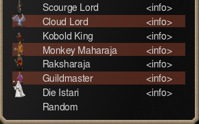
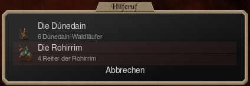

<!-- Generated by scripts/gen_docs_commands.py in the CoE5SE sources from docs/commands-page/languages.md. Edit it there, not here. -->

# Languages

Translate your mod (or someone else's) into other languages: unit names, descriptions, settings, and Lua script text. Players choose a language on CoE5SE's page in Mod Settings, and every enabled mod switches to that language. A single-language translation mod activates automatically while **Language** is set to **Default** (or to a language no enabled mod declares).

Greek, Cyrillic, and accented European characters work out of the box with vanilla fonts. For Chinese, Japanese, Korean, Thai, or other scripts the vanilla fonts lack, include a font with [`fallbackfont`](#fallbackfont). See [Limits](limits.md#languages) for language and font caps.

!!! info "More in the CoE5 manual"
    Vanilla `translation` and `fontfile` commands are documented under ["Fonts & Translation"](https://www.illwinter.com/coe5/coe5modding.pdf#page=4).

This page walks through two translations of the Istari mod from [Getting Started](../getting-started.md). First the author adds German inside the mod, then another modder adds French as a standalone translation mod.

## Add a language to your mod { #your-mod }

### 1. Dump text to a template { #your-mod-text }

Launch CoE5 with the `--dumpstrings` command-line option (in Steam: **Properties → Launch Options**) and your mod enabled. Beside your mods directory, CoE5SE writes `coe5se_translations/Istari.c5se`, listing every translatable string from your mod as a commented `translation` line.

```c5se title="coe5se_translations/Istari.c5se"
# CoE5SE: translation template for Istari
# Every translatable string CoE5SE found in this mod, listed once each.
# Uncommented lines are currently active translations. Commented lines (#) still need translation:
# fill in the second quoted string and remove the leading #.
# Copy this file into your mod before editing (CoE5SE overwrites this template whenever mods reload).
# No language selected in Mod Settings. Start your file with a language tag and display name:
# language "fr" "Français"

# Istari.c5m
# translation "Istari" ""
# translation "Adds The Istari, a class of wizards with Gandalf among them." ""
# translation "Istar" ""
# translation "Grey Wizard" ""
# translation "Dunedain Ranger" ""
# translation "Rohirrim Rider" ""
# translation "The Istari" ""
# translation "The Istari, wizards sent across the sea to stand against the Shadow." ""

# Istari.lua
# translation "Call for Aid" ""
# translation "Once per game. Dunedain Rangers or Rohirrim Riders join Gandalf." ""
# translation "Cancel" ""
```

### 2. Fill in the translations { #your-mod-fill }

Copy the template into your mod's folder as `lang/de.c5se`. Start it with a [`language`](#language) line, fill in each second quoted string, and remove the leading `#`. Leaving an uncommented line with an empty second string (`""`) blanks that text in-game.

```c5se title="Istari/lang/de.c5se"
language "de" "Deutsch"

# Istari.c5m
translation "Istari" "Istari"
translation "Adds The Istari, a class of wizards with Gandalf among them." "Fügt die Istari hinzu, eine Klasse von Zauberern, darunter Gandalf."
translation "Istar" "Istar"
translation "Grey Wizard" "Grauer Zauberer"
translation "Dunedain Ranger" "Dúnedain-Waldläufer"
translation "Rohirrim Rider" "Reiter der Rohirrim"
translation "The Istari" "Die Istari"
translation "The Istari, wizards sent across the sea to stand against the Shadow." "Die Istari, Zauberer, die über das Meer gesandt wurden, um dem Schatten zu trotzen."

# Istari.lua
translation "Call for Aid" "Hilferuf"
translation "Once per game. Dunedain Rangers or Rohirrim Riders join Gandalf." "Einmal pro Spiel. Dúnedain-Waldläufer oder Reiter der Rohirrim schließen sich Gandalf an."
translation "Cancel" "Abbrechen"
translation "The Dunedain" "Die Dúnedain" # (1)!
translation "6 Dunedain Rangers" "6 Dúnedain-Waldläufer"
translation "The Rohirrim" "Die Rohirrim"
translation "4 Rohirrim Riders" "4 Reiter der Rohirrim"
```

1.  These four lines were added by hand. `Istari.lua` stores these strings in a table, and the template extracts only literal strings passed directly to supported `coe5` UI and translation calls.

### 3. Include the file { #your-mod-include }

Add an [`include`](other-commands.md#include) line to your mod. Keep each language in a separate file for clean organization.

```c5m title="Istari/Istari.c5m"
#!@include "lang/de.c5se"
```

### 4. Select the language { #your-mod-pick }

Start CoE5 again. On CoE5SE's page in Mod Settings, **Language** lists every language declared by enabled mods. Select **Deutsch** and leave the page.

<div class="coe5se-shots" markdown>
<figure markdown>

<figcaption>Deutsch, selected in Mod Settings</figcaption>
</figure>
<figure markdown>

<figcaption>The class in Choose Class</figcaption>
</figure>
</div>

<div class="coe5se-shots" markdown>
<figure markdown>

<figcaption>The class description</figcaption>
</figure>
</div>

<div class="coe5se-shots" markdown>
<figure markdown>

<figcaption>Gandalf's orders</figcaption>
</figure>
<figure markdown>

<figcaption>The script's screen</figcaption>
</figure>
</div>

A `translation` line replaces matching text everywhere CoE5 displays it. With the file above, every **Cancel** button in the game becomes **Abbrechen**.

### 5. Check the report { #your-mod-check }

While `--dumpstrings` is enabled, leaving the Mod Settings page with a new language writes `coe5se_translations/report.txt` for that language, counting translated and missing strings per mod. Istari's section:

```text title="coe5se_translations/report.txt"
== Istari: 11 texts, 11 translated, 0 missing ==
Not in any enabled mod: "The Dunedain" (lang/de.c5se line 17)
Not in any enabled mod: "6 Dunedain Rangers" (lang/de.c5se line 18)
Not in any enabled mod: "The Rohirrim" (lang/de.c5se line 19)
Not in any enabled mod: "4 Rohirrim Riders" (lang/de.c5se line 20)
```

The four hand-added lines appear under `"Not in any enabled mod"` because the template scanner did not see them inside direct `coe5` calls. They still translate normally in-game.

## Translate someone else's mod { #another-mod }

You can also ship a standalone translation mod without touching the original mod's files. Here another modder adds French to Istari.

### 1. Create the mod folder { #another-mod-make }

In your mods directory (**Open Mods Directory** on the Mods screen), create a folder with a matching `.c5m` and `.c5se`. The `.c5m` holds the mod banner (a 256 x 64 `.tga` or `.png` in the same folder) and description.

```c5m title="IstariFrench/IstariFrench.c5m"
icon "banner.png"
description "The Istari mod in French."
```

### 2. Dump and fill in the text { #another-mod-text }

Launch CoE5 with `--dumpstrings` and Istari enabled, as in [step 1 above](#your-mod-text). Copy the lines from `coe5se_translations/Istari.c5se` into your `.c5se` under a `language` line and fill them in.

```c5se title="IstariFrench/IstariFrench.c5se"
personalmod # (1)!

language "fr" "Français"
description "Le mod Istari en français." # (2)!

# Istari.c5m
translation "Istari" "Istari"
translation "Adds The Istari, a class of wizards with Gandalf among them." "Ajoute les Istari, une classe de magiciens, dont Gandalf."
translation "Istar" "Istar"
translation "Grey Wizard" "Magicien gris"
translation "Dunedain Ranger" "Rôdeur dúnadan"
translation "Rohirrim Rider" "Cavalier du Rohan"
translation "The Istari" "Les Istari"
translation "The Istari, wizards sent across the sea to stand against the Shadow." "Les Istari, magiciens envoyés par-delà la mer pour s'opposer à l'Ombre."

# Istari.lua
translation "Call for Aid" "Appel à l'aide"
# translation "Once per game. Dunedain Rangers or Rohirrim Riders join Gandalf." ""
translation "Cancel" "Annuler"
```

1.  With [`personalmod`](mod-loading.md#personalmod), each player in a LAN game can use a different translation mod or none.
2.  `IstariFrench`'s description in French.

### 3. Enable both mods { #another-mod-enable }

Because `IstariFrench` is a [single-language translation mod](#language), it activates automatically while **Language** is set to **Default** (if the player selects another available language like Deutsch, that language overrides it).

<div class="coe5se-shots" markdown>
<figure markdown>

<figcaption>Both mods on the Mods screen</figcaption>
</figure>
</div>

<div class="coe5se-shots" markdown>
<figure markdown>

<figcaption>The class in Choose Class</figcaption>
</figure>
<figure markdown>

<figcaption>The class description</figcaption>
</figure>
</div>

### 4. Check what is left { #another-mod-check }

Istari's section of the French report highlights untranslated strings. After the original mod updates, it also flags new strings and obsolete translations whose source text no longer exists. Strings stored in Lua tables do not appear in the template or report, so add those by hand as in the German example.

```text title="coe5se_translations/report.txt"
== Istari: 11 texts, 10 translated, 1 missing ==
Missing: "Once per game. Dunedain Rangers or Rohirrim Riders join Gandalf." (Istari.lua line 16)
```

## The commands { #commands }

### language "&lt;tag&gt;" ["&lt;name&gt;"] <span class="new-badge">New</span> { #language .command data-toc-label="language" data-added="3.6" }

Opens a block of translation lines for one language, ending at the next `language` line or the end of the file. Lines apply whenever a player selects that language in Mod Settings. A content-free translation mod with only one language tag (note that `pt` and `pt-BR` count as two) applies under **Default** as well.

- **tag:** BCP 47 language code such as `de`, `fr`, `pt-BR`, or `zh-Hans`, case-insensitive. If a string has no `pt-BR` translation, it falls back to `pt`.
- **name:** Display name shown in Mod Settings, written in that language (for example, `"Deutsch"`, `"日本語"`). Defaults to `tag` when omitted.

Only lines listed in [What a block holds](#block) are valid inside a language block. Untranslated strings display as written. <!-- vale CoE5SE.Reports = NO -->Any other line does nothing (logged in `coe5mod.log`).<!-- vale CoE5SE.Reports = YES -->

=== ".c5m"

    ```c5m
    #!@language "de" "Deutsch"
    translation "Hobbit Archer" "Hobbit-Bogenschütze"
    ```

=== ".c5se"

    ```c5se
    language "de" "Deutsch"
    translation "Hobbit Archer" "Hobbit-Bogenschütze"
    ```

### fallbackfont "&lt;file&gt;" ["&lt;tag&gt;"] <span class="new-badge">New</span> { #fallbackfont .command data-toc-label="fallbackfont" data-added="3.6" }

Adds a fallback font for characters the vanilla fonts lack, such as Chinese, Japanese, Korean, Thai, or emoji. Declare in your `.c5se`, an included file, or on a `#!@` line in your `.c5m`. Unlike vanilla `fontfile`, it leaves all vanilla fonts intact. Inside a `language` block, it applies only to that language.

- **file:** Path to a `.ttf` or `.otf` font relative to your `.c5m`'s folder, case-sensitive, using the same path rules as `include` (letters, digits, `_`, `-`, `.`, and `/`).
- **tag:** Language tag this font prioritizes (optional). When active, this font is checked first among mod fonts (after vanilla fonts). That way Japanese draws kanji from a Japanese font even with a Chinese font enabled.

Greek, Cyrillic, and Western/Central European accented characters are already covered by vanilla fonts and need no `fallbackfont`.

=== ".c5m"

    ```c5m
    #!@fallbackfont "NotoSansJP-Regular.otf" "ja"
    ```

=== ".c5se"

    ```c5se
    fallbackfont "NotoSansJP-Regular.otf" "ja"
    ```

## What a block holds { #block }

| Line | Behavior inside a language block |
| --- | --- |
| `translation "from" "to"` | Same as vanilla `translation`, scoped to this language. `^` in either string becomes a line break for multi-paragraph text. `#` inside quotes stays part of the text. |
| `include "file"` | Includes a `.c5se` or `.c5m` file from your ROOT `.c5se` or `#!@` lines in `.c5m` (optional leading `./`). The included file inherits the active language block, and is skipped while that language is inactive. |
| `fontfile`, `fallbackfont` | Same as outside a block, scoped to this language. |
| `description "text"` | Translates the mod's description on the Mods screen (applies while off too, when this language is selected). |
| `selectmonster`, `selectitem`, `selectritual`, or `selectaffliction`, followed by `descr "text"` | Translates that monster, item, ritual, or affliction description (matched by name). |
| `selectclass`, followed by `classdescr`, `classabdescr`, `libbonusdescr`, `townbonusdescr`, or `templebonusdescr` | Translates that class description field. |

Language blocks are independent of load order, so a translation mod can load before the mod it translates. A translation mod can also be a plain `.c5m` starting with `#!@language`, which vanilla ignores as a comment. Because language blocks add no gameplay content, pairing them with `personalmod` lets each player in a LAN game use a different language or none.

Text shown by Lua scripts translates automatically through the same table, and `coe5.translate` lets scripts translate strings they format dynamically.

## The --dumpstrings files { #translators }

When launched with `--dumpstrings`, CoE5SE writes two outputs beside your mods directory alongside vanilla's `transtrings.txt`:

- `coe5se_translations/<mod>.c5se`: every translatable string from each enabled mod as `translation` lines, under a `language` header for the active language.
- `coe5se_translations/report.txt`: per-mod counts of translated and missing lines, obsolete entries whose source text disappeared, entries skipped due to mismatched `%` format codes, and characters missing from all loaded fonts.

### Example { #example }

=== ".c5m"

    ```c5m
    #!@include "lang/de.c5se"
    ```

=== ".c5se"

    ```c5se
    include "lang/de.c5se"
    ```

```c5se title="lang/de.c5se"
language "de" "Deutsch"
description "Die Zauberer, Reiche und Völker Mittelerdes. Braucht CoE5SE."
translation "The Eye of Sauron awakens" "Das Auge Saurons erwacht"
translation "Never" "Nie"
translation "Endgame scenarios" "Endspiel-Szenarien"
translation "Hobbit Archer" "Hobbit-Bogenschütze"
translation "Ranger of the North" "Waldläufer des Nordens"
selectritual "Muster of the Dead"
descr "Der Hexenkönig ruft ein bemessenes Heer."
```

## The finished mods { #finished }

<div class="mod-explorer" markdown>
<div class="mod-explorer__layouts">
<button class="mod-explorer__layout" data-layout="own" type="button">Istari in German</button>
<button class="mod-explorer__layout" data-layout="other" type="button">IstariFrench</button>
</div>
<p class="mod-explorer__caption" data-layout="own">The Istari mod after <a href="#your-mod">Add a language to your mod</a>: German in <code>lang/de.c5se</code>, included from <code>Istari.c5m</code>.</p>
<p class="mod-explorer__caption" data-layout="other">The mods directory after <a href="#another-mod">Translate someone else's mod</a>: <code>IstariFrench</code> alongside <code>Istari</code>, leaving Istari's files untouched.</p>
<div class="mod-explorer__tree">
<div class="mod-explorer__files" data-layout="own">
<span class="mod-explorer__folder">Istari/</span>
<button class="mod-explorer__file" data-file="de-c5m" type="button">Istari.c5m</button>
<button class="mod-explorer__file" data-file="lua" type="button">Istari.lua</button>
<button class="mod-explorer__file" data-file="white" type="button">istar.tga</button>
<button class="mod-explorer__file" data-file="grey" type="button">greywizard.tga</button>
<button class="mod-explorer__file" data-file="banner" type="button">banner.png</button>
<span class="mod-explorer__folder mod-explorer__folder--nested">lang/</span>
<button class="mod-explorer__file mod-explorer__file--nested" data-file="de-c5se" type="button">de.c5se</button>
</div>
<div class="mod-explorer__files" data-layout="other">
<span class="mod-explorer__folder">IstariFrench/</span>
<button class="mod-explorer__file" data-file="fr-c5m" type="button">IstariFrench.c5m</button>
<button class="mod-explorer__file" data-file="fr-c5se" type="button">IstariFrench.c5se</button>
<button class="mod-explorer__file" data-file="fr-banner" type="button">banner.png</button>
<span class="mod-explorer__folder">Istari/</span>
<button class="mod-explorer__file" data-file="c5m" type="button">Istari.c5m</button>
<button class="mod-explorer__file" data-file="lua" type="button">Istari.lua</button>
<button class="mod-explorer__file" data-file="white" type="button">istar.tga</button>
<button class="mod-explorer__file" data-file="grey" type="button">greywizard.tga</button>
<button class="mod-explorer__file" data-file="banner" type="button">banner.png</button>
</div>
</div>
<div class="mod-explorer__pane" data-file="de-c5m" markdown>

```c5m title="Istari/Istari.c5m"
icon "banner.png"
description "Adds The Istari, a class of wizards with Gandalf among them."

newmonster "Istar"
copystats "White Wizard"
spr1 "istar.tga"

newmonster "Grey Wizard"
copystats "Pyromancer"
spr1 "greywizard.tga"
#!@fixedname "Gandalf" # (1)!

newmonster "Dunedain Ranger" # (2)!
copystats "Longbowman"

newmonster "Rohirrim Rider"
copystats "Knight"

newclass
setclassname "The Istari"
classdescr "The Istari, wizards sent across the sea to stand against the Shadow."
hometerr 156 # (3)!
setmaincom "Istar" # (4)!
addstartcom "Grey Wizard"
addstartunits "Spearman" 10
addstartunits "Archer" 5
stdtroops
#!@include "lang/de.c5se" # (5)!
```

1.  CoE5SE reads `#!@` lines while vanilla CoE5 ignores them as comments: [The .c5m and the .c5se](../index.md#files).
2.  One of the two units `Istari.lua` spawns on Gandalf's square when he uses Call for Aid.
3.  Terrain 156 is the Crystal Palace, the class's home citadel.
4.  The main commander's sprite (`istar.tga`) also serves as the class icon on the Choose Class screen.
5.  Includes the German translation file from [step 3](#your-mod-include).

</div>
<div class="mod-explorer__pane" data-file="de-c5se" markdown>

```c5se title="Istari/lang/de.c5se"
language "de" "Deutsch"

# Istari.c5m
translation "Istari" "Istari"
translation "Adds The Istari, a class of wizards with Gandalf among them." "Fügt die Istari hinzu, eine Klasse von Zauberern, darunter Gandalf."
translation "Istar" "Istar"
translation "Grey Wizard" "Grauer Zauberer"
translation "Dunedain Ranger" "Dúnedain-Waldläufer"
translation "Rohirrim Rider" "Reiter der Rohirrim"
translation "The Istari" "Die Istari"
translation "The Istari, wizards sent across the sea to stand against the Shadow." "Die Istari, Zauberer, die über das Meer gesandt wurden, um dem Schatten zu trotzen."

# Istari.lua
translation "Call for Aid" "Hilferuf"
translation "Once per game. Dunedain Rangers or Rohirrim Riders join Gandalf." "Einmal pro Spiel. Dúnedain-Waldläufer oder Reiter der Rohirrim schließen sich Gandalf an."
translation "Cancel" "Abbrechen"
translation "The Dunedain" "Die Dúnedain"
translation "6 Dunedain Rangers" "6 Dúnedain-Waldläufer"
translation "The Rohirrim" "Die Rohirrim"
translation "4 Rohirrim Riders" "4 Reiter der Rohirrim"
```

</div>
<div class="mod-explorer__pane" data-file="fr-c5m" markdown>

```c5m title="IstariFrench/IstariFrench.c5m"
icon "banner.png"
description "The Istari mod in French."
```

</div>
<div class="mod-explorer__pane" data-file="fr-c5se" markdown>

```c5se title="IstariFrench/IstariFrench.c5se"
personalmod

language "fr" "Français"
description "Le mod Istari en français."

# Istari.c5m
translation "Istari" "Istari"
translation "Adds The Istari, a class of wizards with Gandalf among them." "Ajoute les Istari, une classe de magiciens, dont Gandalf."
translation "Istar" "Istar"
translation "Grey Wizard" "Magicien gris"
translation "Dunedain Ranger" "Rôdeur dúnadan"
translation "Rohirrim Rider" "Cavalier du Rohan"
translation "The Istari" "Les Istari"
translation "The Istari, wizards sent across the sea to stand against the Shadow." "Les Istari, magiciens envoyés par-delà la mer pour s'opposer à l'Ombre."

# Istari.lua
translation "Call for Aid" "Appel à l'aide"
# translation "Once per game. Dunedain Rangers or Rohirrim Riders join Gandalf." ""
translation "Cancel" "Annuler"
```

</div>
<div class="mod-explorer__pane" data-file="fr-banner" markdown>

`IstariFrench`'s banner, a 256 x 64 `.tga` or `.png`, as in [step 1](#another-mod-make).

</div>
<div class="mod-explorer__pane" data-file="c5m" markdown>

```c5m title="Istari/Istari.c5m"
icon "banner.png"
description "Adds The Istari, a class of wizards with Gandalf among them."

newmonster "Istar"
copystats "White Wizard"
spr1 "istar.tga"

newmonster "Grey Wizard"
copystats "Pyromancer"
spr1 "greywizard.tga"
#!@fixedname "Gandalf" # (1)!

newmonster "Dunedain Ranger" # (2)!
copystats "Longbowman"

newmonster "Rohirrim Rider"
copystats "Knight"

newclass
setclassname "The Istari"
classdescr "The Istari, wizards sent across the sea to stand against the Shadow."
hometerr 156 # (3)!
setmaincom "Istar" # (4)!
addstartcom "Grey Wizard"
addstartunits "Spearman" 10
addstartunits "Archer" 5
stdtroops
```

1.  CoE5SE reads `#!@` lines while vanilla CoE5 ignores them as comments: [The .c5m and the .c5se](../index.md#files).
2.  One of the two units `Istari.lua` spawns on Gandalf's square when he uses Call for Aid.
3.  Terrain 156 is the Crystal Palace, the class's home citadel.
4.  The main commander's sprite (`istar.tga`) also serves as the class icon on the Choose Class screen.

</div>
<div class="mod-explorer__pane" data-file="lua" markdown>

```lua title="Istari/Istari.lua"
-- Once a game, Gandalf calls for aid, and the player picks who answers.
local ANSWERS = {
  {monster = "Dunedain Ranger", count = 6, label = "The Dunedain", line2 = "6 Dunedain Rangers"},
  {monster = "Rohirrim Rider", count = 4, label = "The Rohirrim", line2 = "4 Rohirrim Riders"},
}
local CANCEL = 9

-- The selected commander's unit, when it is a Grey Wizard.
local function selectedGreyWizard()
  local unit = coe5.get("commanderUnit", coe5.get("selectedCommander"))
  if unit >= 0 and coe5.get("unitMonster", unit) == coe5.findMonster("Grey Wizard") then return unit end
end

coe5.addCommanderLine{ -- (1)!
  label = "Call for Aid",
  tooltip = "Once per game. Dunedain Rangers or Rohirrim Riders join Gandalf.",
  visible = function() -- (2)!
    local unit = selectedGreyWizard()
    return unit ~= nil and not coe5.playerData[coe5.get("unitOwner", unit)].calledForAid
  end,
  onClick = function()
    local gandalf = selectedGreyWizard()
    local owner = coe5.get("unitOwner", gandalf)
    while true do
      coe5.ui.screenBegin("Call for Aid")
      for i, answer in ipairs(ANSWERS) do
        coe5.ui.monsterRow(i, coe5.findMonster(answer.monster), answer.label, answer.line2) -- (3)!
      end
      coe5.ui.buttonRow()
      coe5.ui.text(CANCEL, "Cancel")
      coe5.ui.bindEscape(CANCEL)
      local id = coe5.ui.wait() -- (4)!
      if id == CANCEL then return end
      local answer = ANSWERS[id]
      if answer then
        local x, y = coe5.get("unitX", gandalf), coe5.get("unitY", gandalf)
        for _ = 1, answer.count do
          coe5.spawnUnit(owner, coe5.monsterVariant(coe5.findMonster(answer.monster)), x, y) -- (5)!
        end
        coe5.playerData[owner].calledForAid = true
        return
      end
    end
  end,
}
```

1.  Adds a custom order to the selected commander's orders on the map.
2.  Shows the order only while a Grey Wizard is selected and that player has not called for aid yet. Values stored in `coe5.playerData` persist in the save file.
3.  Draws a choice row with the monster's sprite, matching the Recruit screen style.
4.  Displays the screen and waits for the player to select an option, returning that button's ID.
5.  `monsterVariant` picks one of the consecutive monster records sharing the same name, just like recruiting does.

</div>
<div class="mod-explorer__pane" data-file="white" markdown>


</div>
<div class="mod-explorer__pane" data-file="grey" markdown>


</div>
<div class="mod-explorer__pane" data-file="banner" markdown>


</div>
</div>
