<!-- Generated by scripts/gen_docs_commands.py in the CoE5SE sources from docs/commands-page/making-trees.md. Edit it there, not here. -->

# Making Trees

Give a custom mod terrain or custom plane a forest of custom trees, or replace the trees on vanilla Forest (`2`), Enchanted Forest (`8`), Dead Forest (`36`), or any other terrain, with control over sprite variety, density, height, wind sway, and shading.


This guide walks through that main workflow using three free sprites from itch.io, then covers density, sway, and optional seasonal/dead versions. See [Terrain Scatter](terrain-scatter.md) for full syntax and [Limits](limits.md#terrain-scatter) for caps.

## How vanilla CoE5 draws trees { #vanilla-trees }

CoE5 draws Forest (`2`) and Enchanted Forest (`8`) in four versions based on each square's ground and cold flag, plus a fifth version for Dead Forest (`36`):

- **Snow ground:** Applied whenever a square's effective temperature drops below 1 (most Forest squares on Elysium in Winter, or near cold-spreading sites and units). Autumn and Spring draw Summer's trees.
- **Cold flag:** Set once during world generation on squares at temperature 25 or less. It never changes during a game, so broadleaf and conifer zones stay fixed.
- **Dead Forest:** Created when a Forest or Enchanted Forest is ruined, burned, chopped, drained, or withered.

<div class="coe5se-shots coe5se-shots--row" markdown>
<figure markdown>
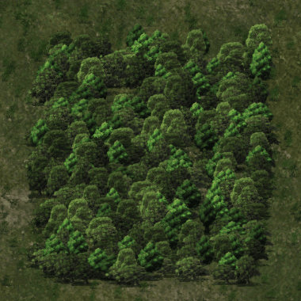
<figcaption>Forest<br>broadleaf</figcaption>
</figure>
<figure markdown>
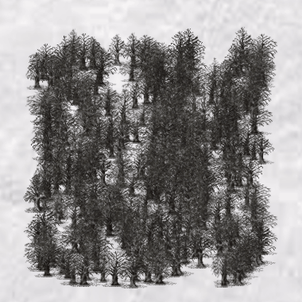
<figcaption><code>snow</code><br>leafless</figcaption>
</figure>
<figure markdown>
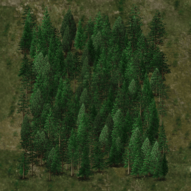
<figcaption><code>cold</code><br>conifers</figcaption>
</figure>
<figure markdown>
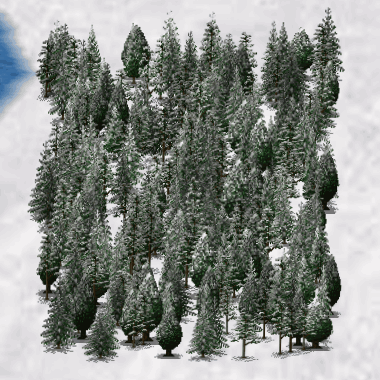
<figcaption><code>snowcold</code><br>snowy conifers</figcaption>
</figure>
<figure markdown>
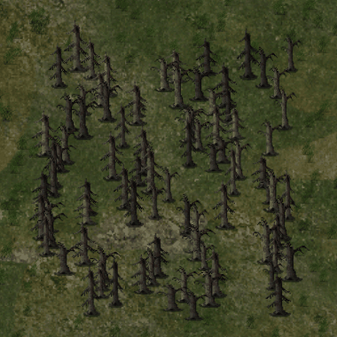
<figcaption>Dead Forest<br>bare trees</figcaption>
</figure>
</div>

| Starter folder | State word | Vanilla sprites (`tree.trs`) | Count | Size | Sway | Shade | Drawn on |
| --- | --- | --- | --- | --- | --- | --- | --- |
| `forest/` | *(none)* | 5 (`16` to `20`, broadleaf) | 40 | 50 | 100 | 50 | Forest (`2`) and Enchanted Forest (`8`), and any unset version |
| `snow/` | `snow` | 6 (`96` to `101`, leafless under snow) | 40 | 50 | 100 | 50 | Snow ground (Winter or cold effects below temperature 1) |
| `cold/` | `cold` | 6 (`22` to `27`, conifers) | 35 | 75 | 100 | 50 | Cold squares (temperature 25 or less at world generation) |
| `snowcold/` | `snowcold` | 6 (`102` to `107`, snowy conifers) | 35 | 75 | 100 | 50 | Snow ground on a cold square |
| `dead/` | *(none, on `selectterr 36`)* | 2 (`38` to `39`, bare trees) | 10 | 70 | 0 | 50 | Dead Forest (`36`) |

Vanilla uses **25 sprites** across all five versions, and **you do not need all 25 to build a mod**. One sprite pack and one plain `terrainscatter` line is enough. Even three sprites look lush in-game because CoE5 randomizes every tree's height from 0.75x to 1.25x and, at vanilla's shade of `50`, brightness from 50% to 100% across each square.

With [`terrainscatter`](terrain-scatter.md#terrainscatter), there is no fixed default count: every line sets its own `count` (trees per square) and its `size`, `sway`, and `shade` as whole percentages, so warm, snow, cold, and dead forests can each use vanilla's numbers or whatever values you want.

??? note "Full list of vanilla tree sprites in `tree.trs` <span class="new-badge">New</span>"
    `terrainscatter` can replace the pieces on any terrain (vanilla or custom) by adding lines inside its `selectterr` block. `--dumptrees` extracts the first five Forest and Dead Forest groups below (25 sprites total):

    | Terrain group | Archive | Sprites | Sprites in group | Vanilla count | Size | Sway | Shade | Dumped by `--dumptrees` |
    | --- | --- | --- | --- | --- | --- | --- | --- | --- |
    | Forest (`2`), Enchanted Forest (`8`) (warm) | `tree.trs` | `16` to `20` | 5 | 40 | 50 | 100 | 50 | Yes (`forest/`) |
    | Forest (`2`), Enchanted Forest (`8`) (snow) | `tree.trs` | `96` to `101` | 6 | 40 | 50 | 100 | 50 | Yes (`snow/`) |
    | Forest (`2`), Enchanted Forest (`8`) (cold) | `tree.trs` | `22` to `27` | 6 | 35 | 75 | 100 | 50 | Yes (`cold/`) |
    | Forest (`2`), Enchanted Forest (`8`) (snow + cold) | `tree.trs` | `102` to `107` | 6 | 35 | 75 | 100 | 50 | Yes (`snowcold/`) |
    | Dead Forest (`36`) | `tree.trs` | `38` to `39` | 2 | 10 | 70 | 0 | 50 | Yes (`dead/`) |
    | Shadow Wood (`37`), Recuperating Ancient Forest (`314`) | `tree.trs` | `34` to `37` | 4 | 35 (Shadow Wood) / 15 | 75 | 0 | 50 | No |
    | Destroyed Jungle (`116`) | `tree.trs` | `44` to `45` | 2 | 20 + 40 | 50 / 30 | 50 | 50 | No |
    | Oasis (`98`), Trading Post (`74`), hot Farm and Hamlet (palms) | `tree.trs` | `46` to `48` | 3 | 50 (ring) / 1 to 3 | 35 / 40 | 100 | 50 | No |
    | Sacred Grove (`236`), Grove of Gaia (`237`), Primal Forest (`238`) | `tree.trs` | `70`, `71`, `72` | 3 | 20 / 15 (ring) | 50 | 100 | 30 | No |
    | Jungle (`115`), Wild Forest (`294`), Enchanted Jungle (`349`), Skull Cave (`157`), Tribe Villages | `tree.trs` | `136` to `141` | 6 | 35 (Jungle) / 11 to 12 | 50 / 60 / 45 | 100 | 50 | No |
    | Kelp Forest (`311`) | `tree.trs` | `142` to `147` | 6 | 35 | 65 | 100 | 50 | No |
    | Eerie Farm (`315`, blossom tree) | `tree.trs` | `149` | 1 | 3 | 50 | 100 | 25 | No |
    | Ancient Forest (`4`), Forest of the Horned One (`293`), Recuperating Ancient Forest (`314`), Ancient Troll Forest (`131`) | `terrain.trs` | `4` | 1 | 1 | 100 (70 Recuperating) | 25 | 10 | No |

    Sprites `21` and `28` to `33` in `tree.trs` are unused by any vanilla recipe. Brigand Lair, Farm, Hamlet, Coastal Hamlet, Troll Forest, Ancient Troll Forest, Troll Pit, Tower, Hut, Tent Village, Spider Thicket, Ghost Farm, Ghost Hamlet, and Coastal Ghost Hamlet also scatter subsets of `16` to `27`, `38` to `39`, and `96` to `107`; `terrainscatter` changes only the terrains whose `selectterr` blocks hold scatter lines.

## 1. Dump the vanilla starter kit (`--dumptrees`) { #dumptrees }

Extract the vanilla trees from your local copy of CoE5 to inspect exact sprite sizes, silhouettes, brightness, and ground shadows.

Launch CoE5 once with the `--dumptrees` command-line option (in Steam: **Properties → Launch Options**). CoE5SE reads `tree.trs` and creates a starter mod in `coe5se_trees/TreeStarter/` beside your mods directory:

```text
coe5se_trees/TreeStarter/
├── TreeStarter.c5m        # sprite packs and terrainscatter lines for Forest, Enchanted Forest, and Dead Forest
├── banner.tga
├── trees.tga              # labeled reference sheet of all 25 vanilla trees with terrainscatter numbers
├── forest/                # 16.tga to 20.tga (5 broadleaf trees)
├── snow/                  # 96.tga to 101.tga (6 leafless trees under snow)
├── cold/                  # 22.tga to 27.tga (6 conifers)
├── snowcold/              # 102.tga to 107.tga (6 snowy conifers)
└── dead/                  # 38.tga and 39.tga (2 bare dead trees)
```

Open `trees.tga` to see every version side by side with its sprite numbers and `terrainscatter` numbers. To recolor or paint over vanilla trees, copy `TreeStarter` into your mods directory (**Open Mods Directory** on the Mods screen) and edit the `.tga` files inside. Running `--dumptrees` again writes only missing files and leaves edited files untouched.

## 2. Grab or paint tree sprites { #sprites }

You can paint sprites from scratch, edit the dumped templates, or start from an asset pack. This walkthrough uses three hardwood trees (`tree_d0001.png`, `tree_e0001.png`, `tree_f0001.png`) from a free itch.io pack: [Free Tree Sprites by klamtii](https://klamtii.itch.io/tree-sprites) (licensed for commercial and non-commercial use and redistribution).

<div class="coe5se-shots" markdown>
<figure markdown>
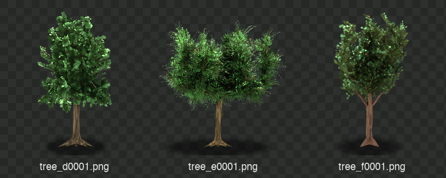
<figcaption>Three hardwood sprites from <a href="https://klamtii.itch.io/tree-sprites">klamtii's Free Tree Sprites</a> on itch.io</figcaption>
</figure>
</div>

### How CoE5SE fits sprites on load

CoE5SE accepts `.png` or `.tga` files with transparency (an alpha channel, or an opaque 24-bit image using CoE5's black transparency and magenta shadow color keys). On first draw, CoE5SE prepares a fitted copy:

1. **Trims transparent margins:** Empty transparent rows and columns on all four sides are cropped off first, so downloaded sprites with blank space below the roots still stand on the ground. Every pixel with alpha above 0 counts toward the trimmed box.
2. **Picks a 64 x 64 or 128 x 128 canvas:** If both trimmed sides are 64 px or less, CoE5SE uses a 64 x 64 square (vanilla tree size). If either trimmed side exceeds 64 px, it uses a 128 x 128 square.
3. **Scales down only past 128 px:** If either trimmed side exceeds 128 px, CoE5SE scales the sprite down proportionally to fit inside 128 x 128. Sprites 128 px or smaller are never scaled up.
4. **Centers on the bottom row:** The sprite is centered horizontally and anchored on the bottom row of the canvas.

!!! warning "Target 64 px tall or 128+ px tall"
    The full 64 x 64 or 128 x 128 canvas maps to your line's `size` on the map (`50`% of a square for vanilla Forest, `75`% for cold conifers, `70`% for Dead Forest). A sprite trimmed to 65 to 127 px tall jumps onto the 128 canvas without scaling up, so a 70 px tree draws at 55% height (shorter than a 64 px tree). Watch out for wide ground shadows or stray faint alpha pixels pushing a 64 px sprite past 64 px wide.

!!! tip "Match brightness and add a ground shadow"
    Asset-pack renders often look darker than CoE5's terrain and can appear to float without a shadow. Lifting midtones to match your `--dumptrees` reference sheet and adding a soft semi-transparent oval under the trunk base helps downloaded trees sit on Elysium's map.

<div class="coe5se-shots" markdown>
<figure markdown>
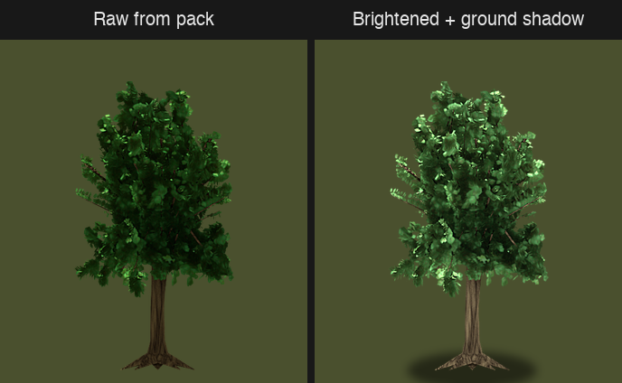
<figcaption>Raw sprite from the pack vs. brightened with a subtle ground shadow</figcaption>
</figure>
</div>

!!! note "Sprite changes need a game restart"
    CoE5SE caches each fitted sprite (and any decode failure) once per launch. Editing a `.c5m` file reloads when you open **Mods** and select **Exit**, but overwriting an image file at the same path requires restarting CoE5.

## 3. Make one custom tree terrain (the main workflow) { #custom-terrain }

The most common goal is creating **one new tree terrain** for a region or custom plane, backed by a single sprite pack pointing at a folder of sprites, with sway set to `100` for vanilla Forest sway or `0` for still features.

Declare the sprite pack with [`newspritepack`](terrain-scatter.md#newspritepack) and `spr`, then define the terrain with `selectterr` (numbers 356 to 1999; see ["Terrain Modding"](https://www.illwinter.com/coe5/coe5modding.pdf#page=30)) and mark it `invisible` to hide its flat `spr` sprite. Add a [`terrainscatter`](terrain-scatter.md#terrainscatter) line inside `selectterr` and give the terrain blended ground with `terrainlooks`, prefixing CoE5SE lines with `#!@` in the same `.c5m` file. Explore both the **new custom terrain** setup (default) and the **replace vanilla Forest** alternative below:

<div class="mod-explorer" markdown>
<div class="mod-explorer__layouts">
<button class="mod-explorer__layout" data-layout="custom" type="button">New custom terrain (sway on/off)</button>
<button class="mod-explorer__layout" data-layout="vanilla" type="button">Replace vanilla Forest</button>
</div>
<p class="mod-explorer__caption" data-layout="custom">The main workflow: one new custom terrain (<code>593</code>) for a region or custom plane using three sprites from <a href="https://klamtii.itch.io/tree-sprites">klamtii's Free Tree Sprites</a>, with vanilla sway (<code>100</code>) or <code>0</code> for still features.</p>
<p class="mod-explorer__caption" data-layout="vanilla">Alternative: replace vanilla Forest (<code>2</code>) and Enchanted Forest (<code>8</code>) across the map with the same three sprites.</p>
<div class="mod-explorer__tree">
<div class="mod-explorer__files" data-layout="custom">
<span class="mod-explorer__folder">PackForest/</span>
<button class="mod-explorer__file" data-file="custom-c5m" type="button">PackForest.c5m</button>
<button class="mod-explorer__file" data-file="pf-banner" type="button">banner.png</button>
<span class="mod-explorer__folder mod-explorer__folder--nested">forest/</span>
<button class="mod-explorer__file mod-explorer__file--nested" data-file="pf-t1" type="button">tree_d0001.png</button>
<button class="mod-explorer__file mod-explorer__file--nested" data-file="pf-t2" type="button">tree_e0001.png</button>
<button class="mod-explorer__file mod-explorer__file--nested" data-file="pf-t3" type="button">tree_f0001.png</button>
</div>
<div class="mod-explorer__files" data-layout="vanilla">
<span class="mod-explorer__folder">PackForest/</span>
<button class="mod-explorer__file" data-file="vanilla-c5m" type="button">PackForest.c5m</button>
<button class="mod-explorer__file" data-file="pf-banner" type="button">banner.png</button>
<span class="mod-explorer__folder mod-explorer__folder--nested">forest/</span>
<button class="mod-explorer__file mod-explorer__file--nested" data-file="pf-t1" type="button">tree_d0001.png</button>
<button class="mod-explorer__file mod-explorer__file--nested" data-file="pf-t2" type="button">tree_e0001.png</button>
<button class="mod-explorer__file mod-explorer__file--nested" data-file="pf-t3" type="button">tree_f0001.png</button>
</div>
</div>
<div class="mod-explorer__pane" data-file="custom-c5m" markdown>

```c5m title="PackForest/PackForest.c5m"
icon "./banner.png"
description "Adds Fangorn (terrain 593) with three hardwood sprites from klamtii.itch.io/tree-sprites."
needs_script_extender # (1)!

#!@newspritepack "Fangorn Trees" # (2)!
#!@spr "./forest/"

selectterr 593 # (3)!
name "Fangorn"
apcost 2
herbs 1
fungus 1
lifeforce 30
forest # (4)!
burnable
nosight
invisible # (5)!
#!@terrainscatter "Fangorn Trees" 35 50 100 50 # (6)!
# #!@terrainscatter "Fangorn Trees" 35 50 0 50 # (7)!

#!@terrainlooks 593 # (8)!
#!@terrainground 2
#!@end
```

1.  Stops vanilla CoE5 with a Mod Error if CoE5SE is not running: [`needs_script_extender`](mod-loading.md#needs-script-extender).
2.  Declares a sprite pack above the terrain that uses it and loads every `.tga` and `.png` in `forest/` (exceeding the [sprite pack cap](limits.md#terrain-scatter) triggers a Mod Error). The pack ends automatically at the next command.
3.  Defines a custom terrain in the mod range (`356` to `1999`). Use `593` in your plane, map file, or events to place it.
4.  Adding `forest` and `burnable` lets rituals, chopping, and fire target terrain `593`. Add `#!@fullforest` right after `forest` if you also want Heart of the Forest claims, Call of the Wild spawns, and heat conversion to Savanna (see [Forest rules](terrain-scatter.md#forest-rules)). Omit them if you do not want the terrain burned or chopped.
5.  Hides the terrain's flat `spr` sprite so only the blended ground and custom trees draw.
6.  Scatters `"Fangorn Trees"` across each square of terrain `593`: `35` trees per square (vanilla Forest uses `40`), height `50`% of a square, sway `100`% (vanilla Forest sway), shade `50`% (50% to 100% brightness).
7.  Change sway from `100` to `0` to make static trees or spires stand completely still in every season.
8.  Gives terrain `593` vanilla Forest's (`2`) blended grass ground.

</div>
<div class="mod-explorer__pane" data-file="vanilla-c5m" markdown>

```c5m title="PackForest/PackForest.c5m"
icon "./banner.png"
description "Replaces vanilla Forest trees with three hardwood sprites from klamtii.itch.io/tree-sprites."
needs_script_extender

#!@newspritepack "Pack Forest"
#!@spr "./forest/"

selectterr 2 # (1)!
#!@terrainscatter "Pack Forest" 40 50 100 50 # (2)!

selectterr 8
#!@terrainscatter "Pack Forest" 40 50 100 50
```

1.  Terrain `2` is vanilla Forest, and `8` is Enchanted Forest. Both already carry vanilla's `invisible` flag, so no `invisible` line is needed.
2.  Scatters `"Pack Forest"` using vanilla Forest's exact numbers: `40` trees per square, height `50`%, sway `100`%, shade `50`%.

</div>
<div class="mod-explorer__pane" data-file="pf-banner" markdown>

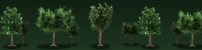

</div>
<div class="mod-explorer__pane" data-file="pf-t1" markdown>

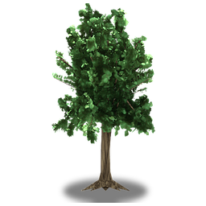

</div>
<div class="mod-explorer__pane" data-file="pf-t2" markdown>

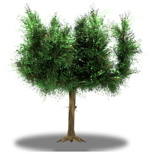

</div>
<div class="mod-explorer__pane" data-file="pf-t3" markdown>

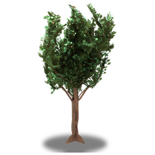

</div>
</div>

Enable the mod on the Mods screen and start a New World. Even with only three sprites in `forest/`, height scaling and brightness variation give every square a full, varied canopy:

<div class="coe5se-shots" markdown>
<figure markdown>
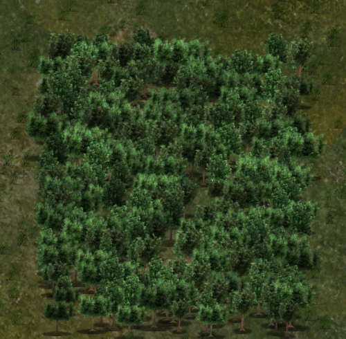
<figcaption>In-game result using only those three sprites at 35 trees per square</figcaption>
</figure>
</div>

## 4. Tune tree density and wind sway { #density-and-sway }

### Wind animation (sway)

The third number on [`terrainscatter`](terrain-scatter.md#terrainscatter) (`0` to `500`) scales that line's wind sway as a percentage of vanilla Forest sway:

- **`0` (most common for static features):** No sway, for petrified woods, dead wastes, or stone spires. With no `snow` or `cold` versions added, Winter and cold squares draw the same still line.
- **`50` / `100`:** Half or full vanilla Forest sway (`100` is vanilla Forest).
- **Up to `500`:** Up to five times vanilla Forest sway.

```c5m title="PetrifiedWood/PetrifiedWood.c5m"
#!@newspritepack "Petrified Wood"
#!@spr "./petrified/"

selectterr 593
name "Petrified Wood"
apcost 2
nosight
invisible
#!@terrainscatter "Petrified Wood" 15 50 0 50 # (1)!

#!@terrainlooks 593
#!@terrainground 2
#!@end
```

1.  The third number (`0`) disables wind movement on these sprites in every season; `15` sets the count, `50` the height, and `50` the shade.

<div class="coe5se-shots" markdown>
<figure markdown>
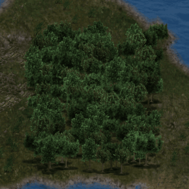
<figcaption>Sway <code>100</code>: vanilla Forest wind sway on PackForest's trees</figcaption>
</figure>
<figure markdown>
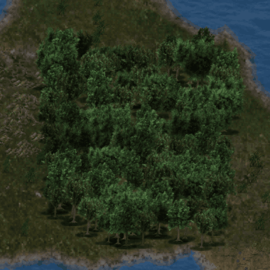
<figcaption>Sway <code>300</code>: three times vanilla Forest sway on the same trees</figcaption>
</figure>
</div>

### Density, size, and shade

The first number on [`terrainscatter`](terrain-scatter.md#terrainscatter) sets `count` (`1` to `100` trees per square at full Graphics Detail; lower Graphics Detail settings thin trees automatically, and a `snow`, `cold`, or `snowcold` version can use `0` to drop the piece on those squares). The second number sets `size` (`1` to `200`, percent of a square), and the fourth sets `shade` (`0` to `100`, how much darker a tree may draw than its picture; `50` is vanilla's 50% to 100% brightness, `0` keeps full brightness).

```c5m title="Fangorn/Fangorn.c5m"
#!@newspritepack "Fangorn Trees"
#!@spr "./forest/"

selectterr 593
name "Fangorn"
apcost 2
nosight
invisible
#!@terrainscatter "Fangorn Trees" 20 50 100 50

#!@terrainlooks 593
#!@terrainground 2
#!@end
```

<div class="coe5se-shots" markdown>
<figure markdown>
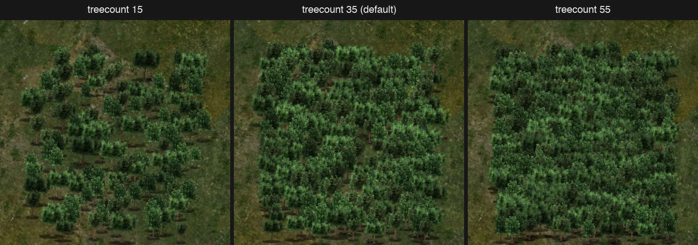
<figcaption>Same three hardwood sprites at count <code>15</code>, <code>35</code>, and <code>55</code></figcaption>
</figure>
</div>

Every `terrainscatter` line sets its own count, size, sway, and shade, so warm, snow, cold, and dead forests can each use different numbers. You can also stack multiple lines in one `selectterr` block (up to the [per-terrain and per-square caps](limits.md#terrain-scatter)) to layer undergrowth, clear a circle in the middle with [`clearcenter`](terrain-scatter.md#terrainscatter), or place one still centerpiece with [`terraincenter`](terrain-scatter.md#terraincenter).

## 5. Optional: Snow, cold, and dead versions { #versions }

Most mods stop at one plain `terrainscatter` line above. With only a plain line set:

- Winter snow squares and cold squares draw that same line (same sprites, count, size, sway, and shade). Cold squares stay at your line's `size` unless you add a `cold` version with a taller size like `75`.
- Dead Forest (`36`) keeps vanilla bare trees.

If you are building a full map overhaul and want distinct Winter, cold, or dead trees, declare a sprite pack for each version and put `snow`, `cold`, or `snowcold` version lines under the plain `terrainscatter` line they replace. Each version line applies to the nearest plain line above it on that terrain and sets its own count, size, sway, and shade. On a snowy cold square, CoE5SE tries `snowcold`, then `cold`, then `snow`, then the plain line; on snow ground it tries `snow`, then the plain line, and on a cold square `cold`, then the plain line. Dead Forest (`36`) is its own terrain, so replace it in its own `selectterr 36` block. Within one mod, all lines on a terrain add up; if several mods put scatter lines on the same terrain, the mod latest in the load order wins.

```c5m title="PackForest/PackForest.c5m"
icon "./banner.png"
description "Replaces vanilla Forest, Enchanted Forest, and Dead Forest with custom sprites."
needs_script_extender

#!@newspritepack "Pack Forest"
#!@spr "./forest/"
#!@newspritepack "Pack Snow"
#!@spr "./snow/"
#!@newspritepack "Pack Cold"
#!@spr "./cold/"
#!@newspritepack "Pack Snow Cold"
#!@spr "./snowcold/"
#!@newspritepack "Pack Dead"
#!@spr "./dead/"

selectterr 2
#!@terrainscatter "Pack Forest" 40 50 100 50
#!@terrainscatter "Pack Snow" 40 50 100 50 snow
#!@terrainscatter "Pack Cold" 35 75 75 50 cold
#!@terrainscatter "Pack Snow Cold" 35 75 100 50 snowcold

selectterr 8
#!@terrainscatter "Pack Forest" 40 50 100 50
#!@terrainscatter "Pack Snow" 40 50 100 50 snow
#!@terrainscatter "Pack Cold" 35 75 75 50 cold
#!@terrainscatter "Pack Snow Cold" 35 75 100 50 snowcold

selectterr 36
#!@terrainscatter "Pack Dead" 15 70 5 50
```

!!! tip "Preview all four states with `--dumpterrain`"
    Launch CoE5 with `--dumpterrain 2 36` (or your custom terrain's number or name, such as `--dumpterrain 593`) to save one `<number>_<name>.tga` sheet per terrain in `coe5se_terrain/`, each showing Plain, Cold, Snow, and Snow and cold patches side by side, without starting a game.

Using conifers (`tree_a0001.png` to `tree_c0001.png`), snow-dusted derivatives, and bare trees (`tree_i0001.png`, `tree_j0001.png`) from klamtii's pack on itch.io:

<div class="coe5se-shots" markdown>
<figure markdown>
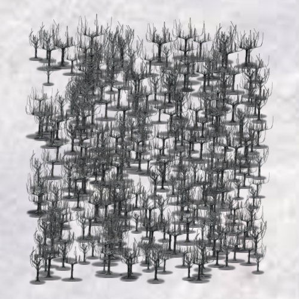
<figcaption>Snowy Forest squares with a <code>snow</code> version line</figcaption>
</figure>
<figure markdown>
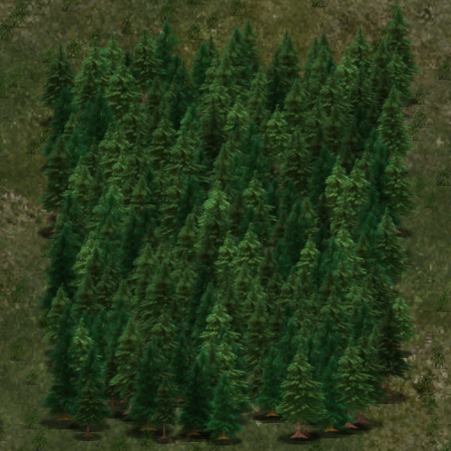
<figcaption>Cold Forest squares with a <code>cold</code> version line</figcaption>
</figure>
<figure markdown>
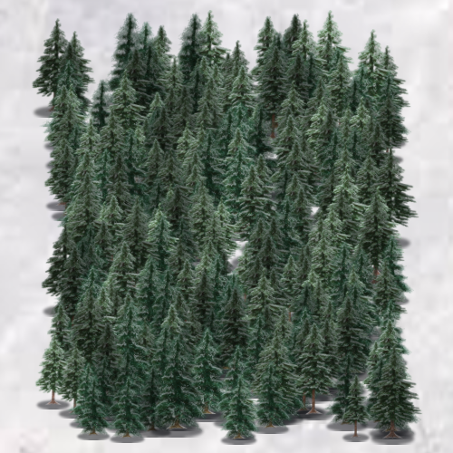
<figcaption>Snowy cold Forest squares with a <code>snowcold</code> version line</figcaption>
</figure>
<figure markdown>
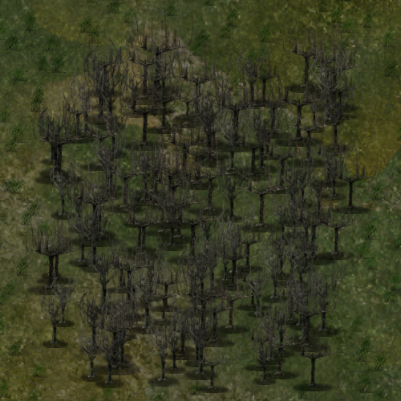
<figcaption>Dead Forest squares on <code>selectterr 36</code> (shown at count <code>15</code>)</figcaption>
</figure>
</div>

## Credits { #credits }

All custom example tree sprites and custom-tree screenshots on this page use [**Free Tree Sprites**](https://klamtii.itch.io/tree-sprites) by **klamtii** on itch.io (licensed for use, modification, and redistribution), brightened and paired with ground shadows to match CoE5's world map.
