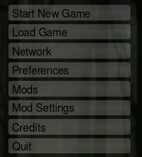
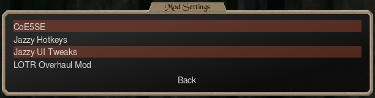
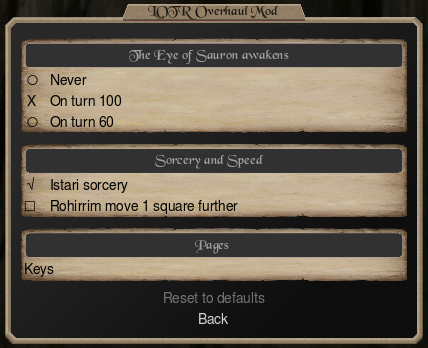

<!-- Generated by scripts/gen_docs_commands.py in the CoE5SE sources from docs/commands-page/mod-settings.md. Edit it there, not here. -->

# Mod Settings

Tie your mod's variables to settings, and you can craft a more dynamic experience around each player's preferences.

<div class="coe5se-shots" markdown>
<figure markdown>

<figcaption>1. On the main menu, Mod Settings</figcaption>
</figure>
<figure markdown>

<figcaption>2. A line for each mod with settings</figcaption>
</figure>
<figure markdown>

<figcaption>3. The mod's page: here, the example settings below</figcaption>
</figure>
</div>

A setting takes two steps. Declare it, so it shows on that page. Then read it in your events or script, where it changes the game.

## Declaring settings

Declare settings in the .c5se, or on `#!@` lines of the .c5m. Each setting is `newsetting`, one kind ([`onoff`](#onoff), [`choice`](#choice) or [`key`](#key)), a `default` and a `label`, in any order.

### newsetting &lt;name&gt; { #newsetting data-toc-label="newsetting" }

Creates a setting.

- **name:** The word your events and scripts read the setting by: 1 to 32 letters, digits and `_`, starting with a letter. Each name once per mod; capitals don't count.

=== ".c5se"

    ```c5se
    newsetting eye_awakens
    ```

=== ".c5m"

    ```c5m
    #!@newsetting eye_awakens
    ```

### onoff { #onoff data-toc-label="onoff" }

Adds a single on/off checkmark. An event with `+setting <name>` happens only while it's checked, and a script reads true or false.

=== ".c5se"

    ```c5se
    onoff
    ```

=== ".c5m"

    ```c5m
    #!@onoff
    ```

### choice { #choice data-toc-label="choice" }

Adds a list of 2 to 8 options, where the player picks one. An event with `+setting <name> <option>` happens only while the player has that option picked, and a script reads the option's number.

=== ".c5se"

    ```c5se
    choice
    ```

=== ".c5m"

    ```c5m
    #!@choice
    ```

### key { #key data-toc-label="key" }

Adds a hotkey, where the player picks which keyboard key does something in your mod. Your Lua script reads the key with `coe5.setting` and gives it its job, such as a shortcut for one of the game's actions (`coe5.rebindKey`).

=== ".c5se"

    ```c5se
    key
    ```

=== ".c5m"

    ```c5m
    #!@key
    ```

### default &lt;value&gt; { #default data-toc-label="default" }

Sets the setting's starting value.

- **value:** 0 or 1 for `onoff`; an option's number for `choice`; a key in double quotes for `key`.

??? note "Key names"

    - A letter, digit or punctuation key is its character: `"y"`, `"7"`, `"?"`. Capitals count: `"B"` is shift+b.
    - Named keys: Space, Tab, Enter, Esc, Backspace, Delete, Home, End, PgUp, PgDn, Up, Down, Left, Right, F1 to F12.
    - Combinations: `ctrl+`, `alt+` or `ctrl+shift+` and a key: `"ctrl+i"`, `"alt+s"`, `"ctrl+F5"`.

=== ".c5se"

    On:

    ```c5se
    default 1
    ```

    Or a key:

    ```c5se
    default "p"
    ```

=== ".c5m"

    On:

    ```c5m
    #!@default 1
    ```

    Or a key:

    ```c5m
    #!@default "p"
    ```

### label "&lt;text&gt;" { #label data-toc-label="label" }

Sets the setting's text on the page, or a sub-page's name after `newsettingpage`. Up to 56 characters.

=== ".c5se"

    ```c5se
    label "The Eye of Sauron awakens"
    ```

=== ".c5m"

    ```c5m
    #!@label "The Eye of Sauron awakens"
    ```

### option &lt;number&gt; "&lt;text&gt;" { #option data-toc-label="option" }

Adds an option to a `choice`.

- **number:** 0 to 7, with no gaps.
- **text:** Up to 56 characters.

=== ".c5se"

    ```c5se
    option 1 "On turn 100"
    ```

=== ".c5m"

    ```c5m
    #!@option 1 "On turn 100"
    ```

### optiontip &lt;number&gt; "&lt;text&gt;" { #optiontip data-toc-label="optiontip" }

Sets an option's hover text, up to 255 characters.

=== ".c5se"

    ```c5se
    optiontip 2 "A short game: Mordor marches early."
    ```

=== ".c5m"

    ```c5m
    #!@optiontip 2 "A short game: Mordor marches early."
    ```

### tip "&lt;text&gt;" { #tip data-toc-label="tip" }

Sets the hover text of an `onoff` or `key` setting, up to 255 characters.

=== ".c5se"

    ```c5se
    tip "Every turn of spring, every player gains 5 fire."
    ```

=== ".c5m"

    ```c5m
    #!@tip "Every turn of spring, every player gains 5 fire."
    ```

### restart { #restart data-toc-label="restart" }

Asks the player to restart the game when they leave your page with the setting changed.

=== ".c5se"

    ```c5se
    restart
    ```

=== ".c5m"

    ```c5m
    #!@restart
    ```

### group "&lt;word&gt;" { #group data-toc-label="group" }

Stops the `key` settings of one group in your mod from holding the same key.

=== ".c5se"

    ```c5se
    group "ring"
    ```

=== ".c5m"

    ```c5m
    #!@group "ring"
    ```

### fixed { #fixed data-toc-label="fixed" }

Stops the player changing a `key` setting.

=== ".c5se"

    ```c5se
    fixed
    ```

=== ".c5m"

    ```c5m
    #!@fixed
    ```

### newsettingheader "&lt;title&gt;" { #newsettingheader data-toc-label="newsettingheader" }

Puts the `onoff` and `key` settings after it in a box with this title, up to the next `newsettingheader` or `choice`. Follow it with an `onoff` or `key` setting. The title is up to 56 characters.

=== ".c5se"

    ```c5se
    newsettingheader "Sorcery and Speed"
    ```

=== ".c5m"

    ```c5m
    #!@newsettingheader "Sorcery and Speed"
    ```

### newsettingpage &lt;name&gt; { #newsettingpage data-toc-label="newsettingpage" }

Puts the settings after it on a sub-page, up to the next `newsettingpage`. Give it a `label`.

=== ".c5se"

    ```c5se
    newsettingpage keys
    label "Keys"
    ```

=== ".c5m"

    ```c5m
    #!@newsettingpage keys
    #!@label "Keys"
    ```

### Example settings { #example }

=== ".c5se"

    ```c5se
    newsetting eye_awakens
    choice
    default 1
    label "The Eye of Sauron awakens"
    option 0 "Never"
    optiontip 0 "Sauron sleeps: no endgame."
    option 1 "On turn 100"
    option 2 "On turn 60"
    optiontip 2 "A short game: Mordor marches early."

    newsettingheader "Sorcery and Speed"

    newsetting istari_sorcery
    onoff
    default 1
    label "Istari sorcery"
    tip "Every turn of spring, every player gains 5 fire."

    newsetting swift_cavalry
    onoff
    default 0
    label "Rohirrim move 1 square further"
    restart

    newsettingpage keys
    label "Keys"

    newsetting ring_next
    key
    default "n"
    label "Next Ring-bearer"
    group "ring"

    newsetting ring_previous
    key
    default "b"
    label "Previous Ring-bearer"
    group "ring"

    newsetting close_map
    key
    default "x"
    label "Close the map of Middle-earth"
    fixed
    ```

=== ".c5m"

    ```c5m
    #!@newsetting eye_awakens
    #!@choice
    #!@default 1
    #!@label "The Eye of Sauron awakens"
    #!@option 0 "Never"
    #!@optiontip 0 "Sauron sleeps: no endgame."
    #!@option 1 "On turn 100"
    #!@option 2 "On turn 60"
    #!@optiontip 2 "A short game: Mordor marches early."

    #!@newsettingheader "Sorcery and Speed"

    #!@newsetting istari_sorcery
    #!@onoff
    #!@default 1
    #!@label "Istari sorcery"
    #!@tip "Every turn of spring, every player gains 5 fire."

    #!@newsetting swift_cavalry
    #!@onoff
    #!@default 0
    #!@label "Rohirrim move 1 square further"
    #!@restart

    #!@newsettingpage keys
    #!@label "Keys"

    #!@newsetting ring_next
    #!@key
    #!@default "n"
    #!@label "Next Ring-bearer"
    #!@group "ring"

    #!@newsetting ring_previous
    #!@key
    #!@default "b"
    #!@label "Previous Ring-bearer"
    #!@group "ring"

    #!@newsetting close_map
    #!@key
    #!@default "x"
    #!@label "Close the map of Middle-earth"
    #!@fixed
    ```

## Reading settings

Events read a setting with [`+setting`](#setting), with no script needed. A Lua script reads one with `coe5.setting("<name>")`.

!!! warning
    In network games, no event with `+setting` or `-setting` happens.

### +setting &lt;name&gt; [index] { #setting data-toc-label="+setting" }

Makes an event happen only while the setting is on, or while a `key` setting has a key. `-setting` is the opposite. Goes in an event, in the .c5se or the .c5m.

- **index:** For a `choice`, the option the player picked; for a `key`, the key it holds.

=== ".c5se"

    While it is on:

    ```c5se
    +setting istari_sorcery
    ```

    Or while a choice has option 1:

    ```c5se
    +setting eye_awakens 1
    ```

=== ".c5m"

    While it is on:

    ```c5m
    #!@+setting istari_sorcery
    ```

    Or while a choice has option 1:

    ```c5m
    #!@+setting eye_awakens 1
    ```

### Example events { #example-events }

The events that read the example settings above:

=== ".c5se"

    ```c5se
    playerevent
    +turnnbr 100
    +setting eye_awakens 1
    message -2 "The Eye of Sauron opens. Mordor marches on the free peoples."
    endevent

    playerevent
    +turnnbr 60
    +setting eye_awakens 2
    message -2 "The Eye of Sauron opens. Mordor marches on the free peoples."
    endevent

    playerevent
    +season 3
    +setting istari_sorcery
    addresources -2 7 5
    endevent
    ```

=== ".c5m"

    ```c5m
    playerevent
    +turnnbr 100
    #!@+setting eye_awakens 1
    message -2 "The Eye of Sauron opens. Mordor marches on the free peoples."
    endevent

    playerevent
    +turnnbr 60
    #!@+setting eye_awakens 2
    message -2 "The Eye of Sauron opens. Mordor marches on the free peoples."
    endevent

    playerevent
    +season 3
    #!@+setting istari_sorcery
    addresources -2 7 5
    endevent
    ```
