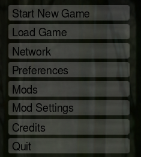
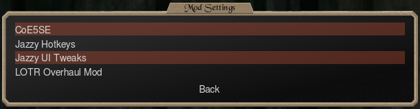
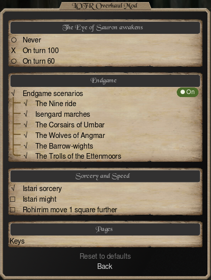
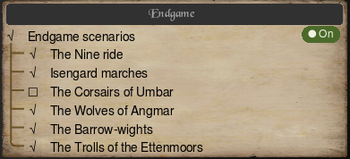
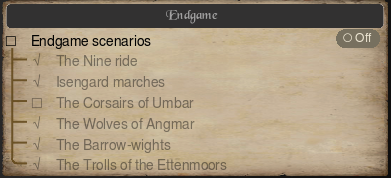

<!-- Generated by scripts/gen_docs_commands.py in the CoE5SE sources from docs/commands-page/mod-settings.md. Edit it there, not here. -->

# Mod Settings

Tie your mod's variables to settings, and you can craft a more dynamic experience around each player's preferences.

<div class="coe5se-shots" markdown>
<figure markdown>

<figcaption>1. On the main menu, Mod Settings</figcaption>
</figure>
<figure markdown>

<figcaption>2. A line for each mod with settings</figcaption>
</figure>
<figure markdown>

<figcaption>3. The mod's page: here, the example settings below</figcaption>
</figure>
</div>

Adding a setting takes two steps: declare it so it appears on your mod's Mod Settings page, then read it in your events or Lua script.

## Setting types

Declare settings in your `.c5se`, or on `#!@` lines in your `.c5m`. Each setting block needs `newsetting`, one type ([`onoff`](#onoff), [`choice`](#choice), or [`key`](#key)), a `default`, and a `label`, in any order. See [Limits](limits.md#mod-settings) for text length and option caps.

### newsetting &lt;name&gt; { #newsetting .command data-toc-label="newsetting" data-added="2.0" }

Declares a new setting.

- **name:** Identifier used by events and Lua scripts: letters, digits, and `_`, starting with a letter. Unique per mod, case-insensitive.

=== ".c5m"

    ```c5m
    #!@newsetting eye_awakens
    ```

=== ".c5se"

    ```c5se
    newsetting eye_awakens
    ```

### onoff { #onoff .command data-toc-label="onoff" data-added="2.0" }

Makes the setting an on/off checkbox. Events with `+setting <name>` run only while checked, and Lua reads `true` or `false`.

=== ".c5m"

    ```c5m
    #!@onoff
    ```

=== ".c5se"

    ```c5se
    onoff
    ```

### choice { #choice .command data-toc-label="choice" data-added="2.0" }

Makes the setting a list of 2 to 8 radio options where the player picks one. Events with `+setting <name> <option>` run only while that option is selected, and Lua reads the option's number.

=== ".c5m"

    ```c5m
    #!@choice
    ```

=== ".c5se"

    ```c5se
    choice
    ```

### key { #key .command data-toc-label="key" data-added="2.0" }

Makes the setting a hotkey that players can bind to a keyboard key. Your Lua script reads the bound key with `coe5.setting` and assigns its action (for example, rebinding a game shortcut with `coe5.rebindKey`).

=== ".c5m"

    ```c5m
    #!@key
    ```

=== ".c5se"

    ```c5se
    key
    ```

## Setting options and behavior

### default &lt;value&gt; { #default .command data-toc-label="default" data-added="2.0" }

Sets the setting's default value.

- **value:** `0` or `1` for `onoff`, an option number for `choice`, or a key name in double quotes for `key` (or `"none"` for unbound).

??? note "Key names"

    - Letters, digits, and punctuation use their character: `"y"`, `"7"`, `"?"`. Case counts: `"B"` is `shift+b`.
    - Named keys: `Space`, `Tab`, `Enter`, `Esc`, `Backspace`, `Delete`, `Home`, `End`, `PgUp`, `PgDn`, `Up`, `Down`, `Left`, `Right`, `F1` to `F12`, and `none`.
    - Combinations: `ctrl+`, `alt+`, or `ctrl+shift+` followed by a key: `"ctrl+i"`, `"alt+s"`, `"ctrl+F5"`. (`ctrl+shift+` accepts letters only; `Esc` cannot be combined or bound by players, and defaulting to `"Esc"` automatically makes the setting `fixed`.)

=== ".c5m"

    On:

    ```c5m
    #!@default 1
    ```

    Or a key:

    ```c5m
    #!@default "p"
    ```

=== ".c5se"

    On:

    ```c5se
    default 1
    ```

    Or a key:

    ```c5se
    default "p"
    ```

### label "&lt;text&gt;" { #label .command data-toc-label="label" data-added="2.0" }

Sets the setting's display text on the page, or the sub-page's name after `newsettingpage`.

=== ".c5m"

    ```c5m
    #!@label "The Eye of Sauron awakens"
    ```

=== ".c5se"

    ```c5se
    label "The Eye of Sauron awakens"
    ```

### option &lt;number&gt; "&lt;text&gt;" { #option .command data-toc-label="option" data-added="2.0" }

Adds an option to a `choice` setting.

- **number:** Option index starting at `0`, with no gaps.
- **text:** Option display text in double quotes.

=== ".c5m"

    ```c5m
    #!@option 1 "On turn 100"
    ```

=== ".c5se"

    ```c5se
    option 1 "On turn 100"
    ```

### optiontip &lt;number&gt; "&lt;text&gt;" { #optiontip .command data-toc-label="optiontip" data-added="2.0" }

Sets the hover tooltip for one option in a `choice` setting.

- **number:** Index of the `option` this tooltip describes.

=== ".c5m"

    ```c5m
    #!@optiontip 2 "A short game: Mordor marches early."
    ```

=== ".c5se"

    ```c5se
    optiontip 2 "A short game: Mordor marches early."
    ```

### tip "&lt;text&gt;" { #tip .command data-toc-label="tip" data-added="2.0" }

Sets the hover tooltip for an `onoff` or `key` setting. For `choice` settings, use [`optiontip`](#optiontip) on each option instead.

=== ".c5m"

    ```c5m
    #!@tip "Every turn of spring, every player gains 5 fire."
    ```

=== ".c5se"

    ```c5se
    tip "Every turn of spring, every player gains 5 fire."
    ```

### restart { #restart .command data-toc-label="restart" data-added="2.0" }

Prompts the player to restart CoE5 when they leave your settings page after changing this setting. Use this for settings read only once at launch.

=== ".c5m"

    ```c5m
    #!@restart
    ```

=== ".c5se"

    ```c5se
    restart
    ```

### group "&lt;word&gt;" { #group .command data-toc-label="group" data-added="2.0" }

Prevents `key` settings in the same group from sharing a key. If a player binds a key already held by another setting in the group, CoE5SE asks whether to reassign it (or shows a reserved notice if the holder is `fixed`).

=== ".c5m"

    ```c5m
    #!@group "ring"
    ```

=== ".c5se"

    ```c5se
    group "ring"
    ```

### fixed { #fixed .command data-toc-label="fixed" data-added="2.0" }

Locks a `key` setting to its default so players cannot rebind it, while still reserving that key within its `group`.

=== ".c5m"

    ```c5m
    #!@fixed
    ```

=== ".c5se"

    ```c5se
    fixed
    ```

## Layout and grouping

### parent &lt;name&gt; <span class="new-badge">New</span> { #parent .command data-toc-label="parent" data-added="3.4" }

Nests an `onoff` or `key` setting under an `onoff` setting in your mod. Use it when you have multiple options you want attached to a single on/off, like a switch for endgame scenarios with each scenario under it. While the parent is off, child settings appear greyed out and read as off (or no key for a `key` setting). Players' saved picks return when the parent is turned back on.

- **name:** The parent setting's name. It must be an `onoff` setting declared earlier on the same page, with no `parent` itself.

=== ".c5m"

    ```c5m
    #!@parent endgame
    ```

=== ".c5se"

    ```c5se
    parent endgame
    ```





### newsettingheader "&lt;title&gt;" { #newsettingheader .command data-toc-label="newsettingheader" data-added="2.0" }

Groups the `onoff` and `key` settings below it inside a titled box, up to the next `newsettingheader`, `choice`, or `newsettingpage`. Follow it with an `onoff` or `key` setting that has no `parent`.

=== ".c5m"

    ```c5m
    #!@newsettingheader "Sorcery and Speed"
    ```

=== ".c5se"

    ```c5se
    newsettingheader "Sorcery and Speed"
    ```

### newsettingpage &lt;name&gt; { #newsettingpage .command data-toc-label="newsettingpage" data-added="2.0" }

Places the settings below it on a sub-page, up to the next `newsettingpage` or the end of the file. Pair with a `label` for the button text. Sub-pages do not nest.

- **name:** Sub-page identifier: 1 to 32 letters, digits, and `_`, starting with a letter (unique per mod, case-insensitive). Players see its `label` instead.

=== ".c5m"

    ```c5m
    #!@newsettingpage keys
    #!@label "Keys"
    ```

=== ".c5se"

    ```c5se
    newsettingpage keys
    label "Keys"
    ```

### Example settings { #example }

=== ".c5m"

    ```c5m
    #!@newsetting eye_awakens
    #!@choice
    #!@default 1
    #!@label "The Eye of Sauron awakens"
    #!@option 0 "Never"
    #!@optiontip 0 "Sauron sleeps: Mordor never marches."
    #!@option 1 "On turn 100"
    #!@option 2 "On turn 60"
    #!@optiontip 2 "A short game: Mordor marches early."

    #!@newsettingheader "Endgame"

    #!@newsetting endgame
    #!@onoff
    #!@default 1
    #!@label "Endgame scenarios"
    #!@tip "Six threats, from turn 100 to 160."

    #!@newsetting nine_ride
    #!@onoff
    #!@default 1
    #!@label "The Nine ride"
    #!@tip "Turn 100: the Witch-king and eight Ebon Knights near your citadel."
    #!@parent endgame

    #!@newsetting isengard_marches
    #!@onoff
    #!@default 1
    #!@label "Isengard marches"
    #!@tip "Turn 110: an Ogre Chief, 40 Goblins and 6 Trolls near your citadel."
    #!@parent endgame

    #!@newsetting corsairs_land
    #!@onoff
    #!@default 1
    #!@label "The Corsairs of Umbar"
    #!@tip "Turn 120: a Pirate Captain and 30 Pirates near your citadel."
    #!@parent endgame

    #!@newsetting wolves_hunt
    #!@onoff
    #!@default 1
    #!@label "The Wolves of Angmar"
    #!@tip "Turn 130: a Dire Wolf and 30 Wolves near your citadel."
    #!@parent endgame

    #!@newsetting barrow_wights
    #!@onoff
    #!@default 1
    #!@label "The Barrow-wights"
    #!@tip "Turn 140: a Wight King and 20 Wights near your citadel."
    #!@parent endgame

    #!@newsetting ettenmoor_trolls
    #!@onoff
    #!@default 1
    #!@label "The Trolls of the Ettenmoors"
    #!@tip "Turn 160: a Troll King and 10 Trolls near your citadel."
    #!@parent endgame

    #!@newsettingheader "Sorcery and Speed"

    #!@newsetting istari_sorcery
    #!@onoff
    #!@default 1
    #!@label "Istari sorcery"
    #!@tip "Every turn of spring, every player gains 5 fire."

    #!@newsetting istari_might
    #!@onoff
    #!@default 0
    #!@label "Istari might"
    #!@tip "Every turn of spring, every player gains 5 more fire."

    #!@newsetting swift_cavalry
    #!@onoff
    #!@default 0
    #!@label "Rohirrim move 1 square further"
    #!@restart

    #!@newsettingpage keys
    #!@label "Keys"

    #!@newsetting ring_next
    #!@key
    #!@default "n"
    #!@label "Next Ring-bearer"
    #!@group "ring"

    #!@newsetting ring_previous
    #!@key
    #!@default "b"
    #!@label "Previous Ring-bearer"
    #!@group "ring"

    #!@newsetting close_map
    #!@key
    #!@default "x"
    #!@label "Close the map of Middle-earth"
    #!@fixed
    ```

=== ".c5se"

    ```c5se
    newsetting eye_awakens
    choice
    default 1
    label "The Eye of Sauron awakens"
    option 0 "Never"
    optiontip 0 "Sauron sleeps: Mordor never marches."
    option 1 "On turn 100"
    option 2 "On turn 60"
    optiontip 2 "A short game: Mordor marches early."

    newsettingheader "Endgame"

    newsetting endgame
    onoff
    default 1
    label "Endgame scenarios"
    tip "Six threats, from turn 100 to 160."

    newsetting nine_ride
    onoff
    default 1
    label "The Nine ride"
    tip "Turn 100: the Witch-king and eight Ebon Knights near your citadel."
    parent endgame

    newsetting isengard_marches
    onoff
    default 1
    label "Isengard marches"
    tip "Turn 110: an Ogre Chief, 40 Goblins and 6 Trolls near your citadel."
    parent endgame

    newsetting corsairs_land
    onoff
    default 1
    label "The Corsairs of Umbar"
    tip "Turn 120: a Pirate Captain and 30 Pirates near your citadel."
    parent endgame

    newsetting wolves_hunt
    onoff
    default 1
    label "The Wolves of Angmar"
    tip "Turn 130: a Dire Wolf and 30 Wolves near your citadel."
    parent endgame

    newsetting barrow_wights
    onoff
    default 1
    label "The Barrow-wights"
    tip "Turn 140: a Wight King and 20 Wights near your citadel."
    parent endgame

    newsetting ettenmoor_trolls
    onoff
    default 1
    label "The Trolls of the Ettenmoors"
    tip "Turn 160: a Troll King and 10 Trolls near your citadel."
    parent endgame

    newsettingheader "Sorcery and Speed"

    newsetting istari_sorcery
    onoff
    default 1
    label "Istari sorcery"
    tip "Every turn of spring, every player gains 5 fire."

    newsetting istari_might
    onoff
    default 0
    label "Istari might"
    tip "Every turn of spring, every player gains 5 more fire."

    newsetting swift_cavalry
    onoff
    default 0
    label "Rohirrim move 1 square further"
    restart

    newsettingpage keys
    label "Keys"

    newsetting ring_next
    key
    default "n"
    label "Next Ring-bearer"
    group "ring"

    newsetting ring_previous
    key
    default "b"
    label "Previous Ring-bearer"
    group "ring"

    newsetting close_map
    key
    default "x"
    label "Close the map of Middle-earth"
    fixed
    ```

## Reading settings

Events read a setting with [`+setting`](#setting), with no Lua required. Lua scripts read settings with `coe5.setting("<name>")`. In LAN games, [content mods](../lua/lan-games.md#content-mods) use the host's picks (so `+setting` and `-setting` evaluate on the host), while [personal mods](../lua/lan-games.md#personal-mods) use each player's picks.

### +setting &lt;name&gt; [index] { #setting .command data-toc-label="+setting" data-added="1.0" }

Requires the setting to be enabled (or bound to a key, for a `key` setting) for the event to run. `-setting` checks the opposite. Declare inside an event in your `.c5se` or `.c5m`. Naming an undeclared setting fails the event.

- **name:** The setting name from `newsetting`, case-insensitive.
- **index:** Option number for a `choice`, or key value for a `key` setting (optional).

=== ".c5m"

    While it is on:

    ```c5m
    #!@+setting istari_sorcery
    ```

    Or while a choice has option 1:

    ```c5m
    #!@+setting eye_awakens 1
    ```

=== ".c5se"

    While it is on:

    ```c5se
    +setting istari_sorcery
    ```

    Or while a choice has option 1:

    ```c5se
    +setting eye_awakens 1
    ```

### Example events { #example-events }

The events that read the example settings above:

=== ".c5m"

    ```c5m
    playerevent
    +turnnbr 100
    #!@+setting eye_awakens 1
    message -2 "The Eye of Sauron opens. Mordor marches on the free peoples."
    endevent

    playerevent
    +turnnbr 60
    #!@+setting eye_awakens 2
    message -2 "The Eye of Sauron opens. Mordor marches on the free peoples."
    endevent

    playerevent
    +turnnbr 100
    #!@+setting nine_ride
    message -2 "The Nine ride out of Minas Morgul."
    scatterloc 3
    newunits 28 "c*Witch-king of Angmar & 8*Ebon Knight"
    endevent

    playerevent
    +turnnbr 110
    #!@+setting isengard_marches
    message -2 "Saruman's host marches out of Isengard."
    scatterloc 3
    newunits 28 "c*Ogre Chief & 40*Goblin & 6*Troll"
    endevent

    playerevent
    +turnnbr 120
    #!@+setting corsairs_land
    message -2 "The Corsairs of Umbar come ashore."
    scatterloc 3
    newunits 28 "c*Pirate Captain & 30*Pirate"
    endevent

    playerevent
    +turnnbr 130
    #!@+setting wolves_hunt
    message -2 "The wolves of Angmar hunt in the dark."
    scatterloc 3
    newunits 28 "c*Dire Wolf & 30*Wolf"
    endevent

    playerevent
    +turnnbr 140
    #!@+setting barrow_wights
    message -2 "The Barrow-wights leave their mounds."
    scatterloc 3
    newunits 28 "c*Wight King & 20*Wight"
    endevent

    playerevent
    +turnnbr 160
    #!@+setting ettenmoor_trolls
    message -2 "Trolls come down from the Ettenmoors."
    scatterloc 3
    newunits 28 "c*Troll King & 10*Troll"
    endevent

    playerevent
    +season 3
    #!@+setting istari_sorcery
    addresources -2 7 5
    endevent

    playerevent
    +season 3
    #!@+setting istari_sorcery
    #!@+setting istari_might
    addresources -2 7 5
    endevent
    ```

=== ".c5se"

    ```c5se
    playerevent
    +turnnbr 100
    +setting eye_awakens 1
    message -2 "The Eye of Sauron opens. Mordor marches on the free peoples."
    endevent

    playerevent
    +turnnbr 60
    +setting eye_awakens 2
    message -2 "The Eye of Sauron opens. Mordor marches on the free peoples."
    endevent

    playerevent
    +turnnbr 100
    +setting nine_ride
    message -2 "The Nine ride out of Minas Morgul."
    scatterloc 3
    newunits 28 "c*Witch-king of Angmar & 8*Ebon Knight"
    endevent

    playerevent
    +turnnbr 110
    +setting isengard_marches
    message -2 "Saruman's host marches out of Isengard."
    scatterloc 3
    newunits 28 "c*Ogre Chief & 40*Goblin & 6*Troll"
    endevent

    playerevent
    +turnnbr 120
    +setting corsairs_land
    message -2 "The Corsairs of Umbar come ashore."
    scatterloc 3
    newunits 28 "c*Pirate Captain & 30*Pirate"
    endevent

    playerevent
    +turnnbr 130
    +setting wolves_hunt
    message -2 "The wolves of Angmar hunt in the dark."
    scatterloc 3
    newunits 28 "c*Dire Wolf & 30*Wolf"
    endevent

    playerevent
    +turnnbr 140
    +setting barrow_wights
    message -2 "The Barrow-wights leave their mounds."
    scatterloc 3
    newunits 28 "c*Wight King & 20*Wight"
    endevent

    playerevent
    +turnnbr 160
    +setting ettenmoor_trolls
    message -2 "Trolls come down from the Ettenmoors."
    scatterloc 3
    newunits 28 "c*Troll King & 10*Troll"
    endevent

    playerevent
    +season 3
    +setting istari_sorcery
    addresources -2 7 5
    endevent

    playerevent
    +season 3
    +setting istari_sorcery
    +setting istari_might
    addresources -2 7 5
    endevent
    ```
