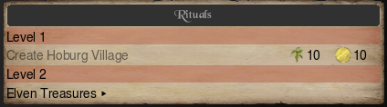
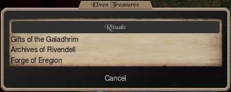

<!-- Generated by scripts/gen_docs_commands.py in the CoE5SE sources from docs/commands-page/ritual-effects.md. Edit it there, not here. -->

# Ritual Effects

Give your rituals additional effects not supported by the base game.

These go after `newritual` or `selectritual`. To cap a summoning string's dice at their highest roll, use [`noexplode`](noexplode.md). To raise only the corpses of a type, use the ritual commands on [Corpses](corpses.md). To teach a ritual by its name, use [`gainrit`](monster-names.md#gainrit).

!!! info "More in the game's manual"
    The game's own ritual commands are in Illwinter's official modding manual, under ["Ritual Modding"](https://www.illwinter.com/coe5/coe5modding.pdf#page=33).

### randomequip { #randomequip .command data-toc-label="randomequip" data-added="2.7" }

Gives the caster one item, picked at random from the ritual's `addstring "|<item>"` lines, like the game's Enter Soul Contract.

=== ".c5m"

    ```c5m
    #!@randomequip
    addstring "|Elven Cloak"
    addstring "|Ring of Protection"
    ```

=== ".c5se"

    ```c5se
    randomequip
    addstring "|Elven Cloak"
    addstring "|Ring of Protection"
    ```

!!! warning "Put the `|` lines first"
    If another `addstring` line comes before them, the ritual gives no item.

### randartifact [group] { #randartifact .command data-toc-label="randartifact" data-added="2.7" }

Gives the caster a random magic item, like the game's Create Artifact.

- **group:** An [item group](#item-groups), by name or number. Items in no group, your mod's new items included, can come too. Each item's group is in "Magic Item Data" in the [CoE5 Data thread](https://steamcommunity.com/app/1606340/discussions/1/3198114142283463845/).

=== ".c5m"

    Any item:

    ```c5m
    #!@randartifact
    ```

    Or a fire item:

    ```c5m
    #!@randartifact fire
    ```

=== ".c5se"

    Any item:

    ```c5se
    randartifact
    ```

    Or a fire item:

    ```c5se
    randartifact fire
    ```

### castermaxcast <value> <span class="new-badge">New</span> { #castermaxcast .command data-toc-label="castermaxcast" data-added="3.4" }

Ritual cannot be cast more than this number of times per commander. Unlike `forgetcurrit`, the commander keeps the ritual greyed out, and a mastery ritual that teaches it again doesn't reset his count.

- **value:** 1 to 32000, or 0 for no limit.

=== ".c5m"

    ```c5m
    #!@castermaxcast 1
    ```

=== ".c5se"

    ```c5se
    castermaxcast 1
    ```

### randitemloc <item> <span class="new-badge">New</span> { #randitemloc .command data-toc-label="randitemloc" data-added="3.9" }

Like `randterrloc`, but sets loc to a random square on active plane where this magic item is, lying on the ground or carried by a commander of an enemy player. Ritual fails when no such item is there. Windows only (for now).

- **item:** `tag "<name>"` for any item with that [`tag`](monster-traits.md#tag), a magic item command like [`indestructible`](magic-items.md#indestructible) or `extralife` for any item that has it, or `"<item name>"` for that one item.

=== ".c5m"

    ```c5m
    #!@randitemloc tag "Silmarils"
    scryloc 5
    ```

    Or any item with a command:

    ```c5m
    #!@randitemloc indestructible
    scryloc 5
    ```

    Or one item, by name:

    ```c5m
    #!@randitemloc "The One Ring"
    scryloc 5
    ```

=== ".c5se"

    ```c5se
    randitemloc tag "Silmarils"
    scryloc 5
    ```

    Or any item with a command:

    ```c5se
    randitemloc indestructible
    scryloc 5
    ```

    Or one item, by name:

    ```c5se
    randitemloc "The One Ring"
    scryloc 5
    ```

### randnewitemloc <item> <span class="new-badge">New</span> { #randnewitemloc .command data-toc-label="randnewitemloc" data-added="3.9" }

Like [`randitemloc`](#randitemloc), but tries to find a square the caster's player cannot see first.

- **item:** As for [`randitemloc`](#randitemloc).

=== ".c5m"

    ```c5m
    #!@randnewitemloc tag "Silmarils"
    scryloc 5
    ```

=== ".c5se"

    ```c5se
    randnewitemloc tag "Silmarils"
    scryloc 5
    ```

### ritualmenu "<name>" <span class="new-badge">New</span> { #ritualmenu .command data-toc-label="ritualmenu" data-added="3.8" }

Puts the ritual in a menu, which the ritual screen shows as one line, `<name> ▸`. A click on the line opens the menu's rituals, each cast as if picked from the list.

- **name:** In double quotes ([length limit](limits.md#ritual-effects)), shared by every mod. Case counts.

When the commander knows only one of the menu's rituals, the ritual screen lists that ritual with no menu line.





=== ".c5m"

    ```c5m
    #!@ritualmenu "Elven Treasures"
    ```

=== ".c5se"

    ```c5se
    ritualmenu "Elven Treasures"
    ```

### Item groups { #item-groups }

??? info "Names and numbers of the five item groups"

    | Name | Number | Items |
    | --- | --- | --- |
    | `fire` | 1 | Fire themed |
    | `water` | 2 | Water themed |
    | `air` | 4 | Air themed |
    | `earth` | 8 | Earth themed |
    | `books` | 16 | Books & scrolls |

### Example rituals { #example }

=== ".c5m"

    ```c5m
    newritpow

    newritual "Gifts of the Galadhrim"
    descr "The Lady of the Golden Wood gives a guest one of her people's treasures."
    level 2
    #!@randomequip
    addstring "|Elven Cloak"
    addstring "|Elven Armor"
    addstring "|Ring of Protection"
    #!@castermaxcast 1
    #!@ritualmenu "Elven Treasures"

    newritual "Forge of Eregion"
    descr "The smiths of Eregion forge a treasure as in the old days."
    level 3
    #!@randartifact
    #!@ritualmenu "Elven Treasures"

    newritual "Archives of Rivendell"
    descr "The house of Elrond gives a scholar a book of the old lore."
    level 2
    #!@randartifact books
    #!@ritualmenu "Elven Treasures"
    ```

=== ".c5se"

    ```c5se
    newritpow

    newritual "Gifts of the Galadhrim"
    descr "The Lady of the Golden Wood gives a guest one of her people's treasures."
    level 2
    randomequip
    addstring "|Elven Cloak"
    addstring "|Elven Armor"
    addstring "|Ring of Protection"
    castermaxcast 1
    ritualmenu "Elven Treasures"

    newritual "Forge of Eregion"
    descr "The smiths of Eregion forge a treasure as in the old days."
    level 3
    randartifact
    ritualmenu "Elven Treasures"

    newritual "Archives of Rivendell"
    descr "The house of Elrond gives a scholar a book of the old lore."
    level 2
    randartifact books
    ritualmenu "Elven Treasures"
    ```
