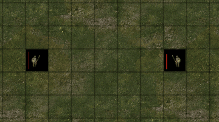
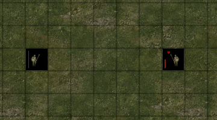

<!-- Generated by scripts/gen_docs_commands.py in the CoE5SE sources from docs/commands-page/weapon-traits.md. Edit it there, not here. -->

# Weapon Traits

Target weapons and spells at any monster trait or custom tag, widen beams, tint weapon visuals, or choose what slain victims turn into.

Declare these commands after `newweapon` or `selectweapon`. Spells inherit them through their weapon. To stop a weapon's damage die from exploding, see [`noexplode`](noexplode.md).

!!! info "More in the CoE5 manual"
    Vanilla weapon commands are documented under ["Weapon Modding"](https://www.illwinter.com/coe5/coe5modding.pdf#page=4).

## Targeting and damage by trait

These commands match any vanilla monster trait, movement, or ability command (spelled as in ["Monster Modding"](https://www.illwinter.com/coe5/coe5modding.pdf#page=14), such as `undead`, `inanimate`, `immortal`, `human`, `flying`, `stonebeing`, or `troll`), CoE5SE's [`small`](monster-traits.md#small) or [`combatcaster`](monster-traits.md#combatcaster), or `tag "<name>"` for a custom [tag](monster-traits.md#tag). Movement flags come from the monster or held items, traits and abilities also include temporary effects, and tags come from the monster only. `flying` does not include `float`, so list both if needed. A `clearwspec` line below these rules removes them.

<!-- vale CoE5SE.Reports = NO -->
!!! warning "Match the manual's exact spelling and case"
    Trait names are case-sensitive. An unrecognized trait (like `onlyaffects trolls`) is ignored and logged in `coe5mod.log`. The mod still loads without error, and the weapon behaves as if that line were not there.
<!-- vale CoE5SE.Reports = YES -->

### onlyaffects &lt;trait&gt; { #onlyaffects .command data-toc-label="onlyaffects" data-added="2.5" }

Restricts the weapon so it affects only units with this trait, like vanilla `affectundead`. Every other unit takes no damage and no effect.

- **trait:** A monster trait, movement or ability command, `small`, `combatcaster`, or `tag "<name>"`. Repeating `onlyaffects` matches units with any listed trait.

=== ".c5m"

    ```c5m
    #!@onlyaffects troll
    ```

    Or a custom tag:

    ```c5m
    #!@onlyaffects tag "Nazgul"
    ```

=== ".c5se"

    ```c5se
    onlyaffects troll
    ```

    Or a custom tag:

    ```c5se
    onlyaffects tag "Nazgul"
    ```

### doesntaffect &lt;trait&gt; { #doesntaffect .command data-toc-label="doesntaffect" data-added="2.5" }

Prevents the weapon from affecting units with this trait, like vanilla `inanimate`. If a unit matches both `onlyaffects` and `doesntaffect`, it is unaffected.

- **trait:** A monster trait, movement or ability command, `small`, `combatcaster`, or `tag "<name>"`. Repeating `doesntaffect` excludes units with any listed trait.

=== ".c5m"

    ```c5m
    #!@doesntaffect immortal
    ```

    Or a custom tag:

    ```c5m
    #!@doesntaffect tag "Nazgul"
    ```

=== ".c5se"

    ```c5se
    doesntaffect immortal
    ```

    Or a custom tag:

    ```c5se
    doesntaffect tag "Nazgul"
    ```

### doubledmgvs &lt;trait&gt; { #doubledmgvs .command data-toc-label="doubledmgvs" data-added="2.5" }

Doubles the weapon's damage against units with this trait, like vanilla `stonekill`. Stacks with vanilla `holykill`, `undkill`, or `stonekill` on the same weapon.

- **trait:** A monster trait, movement or ability command, `small`, `combatcaster`, or `tag "<name>"`. Repeating `doubledmgvs` still doubles damage once when any listed trait matches.

=== ".c5m"

    ```c5m
    #!@doubledmgvs troll
    ```

    Or a custom tag:

    ```c5m
    #!@doubledmgvs tag "Nazgul"
    ```

=== ".c5se"

    ```c5se
    doubledmgvs troll
    ```

    Or a custom tag:

    ```c5se
    doubledmgvs tag "Nazgul"
    ```

## Beam width

### beamwidth &lt;width&gt; [lines] { #beamwidth .command data-toc-label="beamwidth" data-added="3.0" }

Widens a beam weapon beyond vanilla's one-square width, for breaths and beam spells that sweep multiple lanes. Works only on beam areas (`aoe` `10xx` or `50xx` in ["Weapon Modding Numbers"](https://www.illwinter.com/coe5/coe5modding.pdf#page=6)) and has no effect on other `aoe` types.

Like vanilla beams, side lanes hit friendly units unless the weapon has `onlyenemy`. Units aim wide beams as if they were one square wide (for now). `clearwspec` does not reset `beamwidth`. Use `beamwidth 1` to restore a single-square beam.

- **width:** Beam width in squares, 1 to 15. Each lane runs the full beam length (`xx` of its `aoe`). Odd widths center on the aim line, and even widths put the extra lane on one side.
- **lines:** Draws one narrow trail per lane instead of a single wide trail (optional). Best with thin looks like Energy Beam (`flylook 214`), since fire looks (`flylook 95`) blur together. Wide and multi-lane trails require a particle fly mode such as `flymode 4`, while a `flymode 1` sprite flies once down the center at normal size.

=== ".c5m"

    ```c5m
    #!@beamwidth 3
    ```

    Or one trail per lane:

    ```c5m
    #!@beamwidth 3 lines
    ```

=== ".c5se"

    ```c5se
    beamwidth 3
    ```

    Or one trail per lane:

    ```c5se
    beamwidth 3 lines
    ```

<div class="coe5se-shots" markdown>
<figure markdown>

<figcaption><code>beamwidth 3</code>: one wide trail</figcaption>
</figure>
<figure markdown>

<figcaption><code>beamwidth 3 lines</code>: one trail per lane</figcaption>
</figure>
</div>

## Weapon and spell visuals

### lookcolor [smoke] &lt;red&gt; &lt;green&gt; &lt;blue&gt; <span class="new-badge">New</span> { #lookcolor .command data-toc-label="lookcolor" data-added="3.5" }

Tints the weapon's strike `look`, including its smoke particles. Dark colors barely show except on smoke. `clearwspec` leaves colors unchanged.

- **smoke:** Tints only the smoke particles, overriding the color set by a plain `lookcolor` line (optional).
- **red, green, blue:** Color channels from 0 to 255, like `playercolor`.

=== ".c5m"

    ```c5m
    #!@lookcolor 60 220 60
    ```

    Or smoke only:

    ```c5m
    #!@lookcolor smoke 70 110 70
    ```

=== ".c5se"

    ```c5se
    lookcolor 60 220 60
    ```

    Or smoke only:

    ```c5se
    lookcolor smoke 70 110 70
    ```

### flylookcolor [smoke] &lt;red&gt; &lt;green&gt; &lt;blue&gt; <span class="new-badge">New</span> { #flylookcolor .command data-toc-label="flylookcolor" data-added="3.5" }

Tints the weapon's flight `flylook`, including its smoke particles. With `flymode 1`, the flying sprite keeps normal colors while its trail takes the tint. `clearwspec` leaves colors unchanged.

- **smoke:** Tints only the flight smoke particles, overriding the color set by a plain `flylookcolor` line (optional).
- **red, green, blue:** Color channels from 0 to 255.

=== ".c5m"

    ```c5m
    #!@flylookcolor 60 220 60
    ```

    Or smoke only:

    ```c5m
    #!@flylookcolor smoke 70 110 70
    ```

=== ".c5se"

    ```c5se
    flylookcolor 60 220 60
    ```

    Or smoke only:

    ```c5se
    flylookcolor smoke 70 110 70
    ```

## Kill transforms

### reanimate [&lt;type&gt;] "&lt;monster&gt;" { #reanimate .command data-toc-label="reanimate" data-added="3.2" }

Turns victims killed by the weapon into this monster instead of a Soulless. Like vanilla `reanimate`, it skips undead, tiny, ethereal, and inanimate victims, and the victim still leaves a corpse. A `clearwspec` line below it removes custom `reanimate` rules.

- **type:** Restricts this line to victims leaving a specific [corpse type](corpses.md) or group (optional, vanilla or custom in double quotes). Typed lines are checked in order before an untyped fallback, and victims that match no line become Soulless. A second untyped line replaces the first.
- **monster:** Target monster name in double quotes.

=== ".c5m"

    ```c5m
    reanimate "Wight"
    reanimate human "Wraith"
    ```

=== ".c5se"

    ```c5se
    reanimate "Wight"
    reanimate human "Wraith"
    ```

### mutate "&lt;monster&gt;" { #mutate .command data-toc-label="mutate" data-added="3.2" }

Turns victims killed by the weapon into this monster instead of the monster after the killer in the monster list. Like vanilla `mutate`, it skips inanimate and ethereal victims. A second `mutate` line replaces the first, and a `clearwspec` line below it removes custom `mutate` rules.

- **monster:** Target monster name in double quotes.

=== ".c5m"

    ```c5m
    mutate "Goblin"
    ```

=== ".c5se"

    ```c5se
    mutate "Goblin"
    ```

## Example weapons { #example }

=== ".c5m"

    ```c5m
    newweapon "Barrow-blade"
    dmg 6
    #!@doubledmgvs troll
    #!@doubledmgvs immortal

    newweapon "Black Breath"
    dmg 4
    #!@doesntaffect tag "Nazgul"
    #!@doesntaffect demonic

    newweapon "Dawn Light"
    dmg 20
    #!@onlyaffects troll

    newweapon "Flame of Udun"
    range 10
    dmgtype 4
    dmg 15
    aoe 1010
    flymode 4
    flylook 95
    #!@flylookcolor 255 90 20
    #!@flylookcolor smoke 110 30 140
    look 68
    #!@lookcolor 255 90 20
    #!@lookcolor smoke 110 30 140
    #!@beamwidth 15
    onlyenemy

    newweapon "Blade of the Witch-king"
    dmg 8
    reanimate "Wight"
    reanimate human "Wraith"

    newweapon "Torment of Angband"
    dmg 10
    mutate "Goblin"

    newweapon "Light of Earendil"
    range 8
    dmgtype 6
    dmg 10
    aoe 5008
    flymode 4
    flylook 214
    #!@flylookcolor 150 200 255
    #!@beamwidth 3 lines
    #!@doubledmgvs undead
    onlyenemy
    ```

=== ".c5se"

    ```c5se
    newweapon "Barrow-blade"
    dmg 6
    doubledmgvs troll
    doubledmgvs immortal

    newweapon "Black Breath"
    dmg 4
    doesntaffect tag "Nazgul"
    doesntaffect demonic

    newweapon "Dawn Light"
    dmg 20
    onlyaffects troll

    newweapon "Flame of Udun"
    range 10
    dmgtype 4
    dmg 15
    aoe 1010
    flymode 4
    flylook 95
    flylookcolor 255 90 20
    flylookcolor smoke 110 30 140
    look 68
    lookcolor 255 90 20
    lookcolor smoke 110 30 140
    beamwidth 15
    onlyenemy

    newweapon "Blade of the Witch-king"
    dmg 8
    reanimate "Wight"
    reanimate human "Wraith"

    newweapon "Torment of Angband"
    dmg 10
    mutate "Goblin"

    newweapon "Light of Earendil"
    range 8
    dmgtype 6
    dmg 10
    aoe 5008
    flymode 4
    flylook 214
    flylookcolor 150 200 255
    beamwidth 3 lines
    doubledmgvs undead
    onlyenemy
    ```
