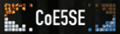
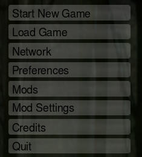
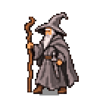
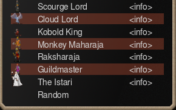
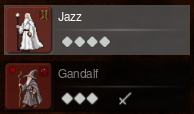
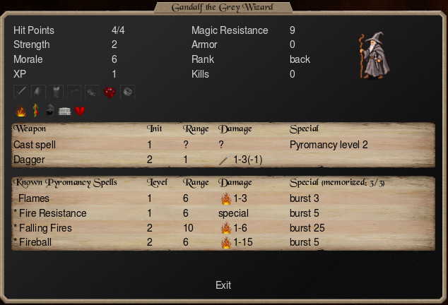
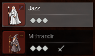
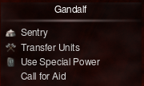
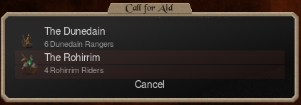

# Getting Started

A CoE5SE mod is a vanilla mod folder that can also hold a .c5se and a Lua script. These files are optional, and when included they need exactly the same name as your .c5m.

## CoE5SE on the main menu { #main-menu }

Install CoE5SE from [GitHub](https://github.com/musical-pianist/coe5se#install) or [Nexus Mods](https://www.nexusmods.com/conquestofelysium5/mods/1). While it runs, the main menu shows its banner at the top right and Mod Settings after Mods.

<div class="coe5se-shots" markdown>
<figure markdown>

<figcaption>CoE5SE's banner</figcaption>
</figure>
<figure markdown>

<figcaption>Mod Settings</figcaption>
</figure>
</div>

## The Istari mod { #build }

The rest of this page shows a working visual example of a CoE5SE mod, and a few different ways to lay out your mod folder. Please note this mod was created as an example only, and is in poor taste.

<div class="mod-explorer" markdown>
<div class="mod-explorer__layouts">
<button class="mod-explorer__layout" data-layout="c5m" type="button">.c5m</button>
<button class="mod-explorer__layout" data-layout="c5se" type="button">.c5se</button>
<button class="mod-explorer__layout" data-layout="split" type="button">.c5m and .c5se</button>
</div>
<p class="mod-explorer__caption" data-layout="c5m">In this example the modder chose to keep one .c5m and extend it with <code>#!@</code> lines. This is a great fit for a mod that works with CoE5 and works even better with CoE5SE.</p>
<p class="mod-explorer__caption" data-layout="c5se">In this example the modder chose to do the bulk of their mod creation in the .c5se.</p>
<p class="mod-explorer__caption" data-layout="split">In this example the modder chose to “sidecar” every CoE5SE edit into a separate file, the .c5se. We pretend the modder really doesn’t want the mod to work in stock CoE5, and needs the script extender because they really want the wizard to be named “Gandalf”. As such, the modder put <code>needs_script_extender</code> in the .c5m, which makes vanilla CoE5 stop with a Mod Error.</p>
<div class="mod-explorer__tree">
<span class="mod-explorer__folder">Istari/</span>
<div class="mod-explorer__files" data-layout="c5m">
<button class="mod-explorer__file" data-file="c5m-c5m" type="button">Istari.c5m</button>
<button class="mod-explorer__file" data-file="lua" type="button">Istari.lua</button>
<button class="mod-explorer__file" data-file="white" type="button">istar.tga</button>
<button class="mod-explorer__file" data-file="grey" type="button">greywizard.tga</button>
<button class="mod-explorer__file" data-file="banner" type="button">banner.png</button>
</div>
<div class="mod-explorer__files" data-layout="c5se">
<button class="mod-explorer__file" data-file="c5se-c5m" type="button">Istari.c5m</button>
<button class="mod-explorer__file" data-file="c5se-c5se" type="button">Istari.c5se</button>
<button class="mod-explorer__file" data-file="lua" type="button">Istari.lua</button>
<button class="mod-explorer__file" data-file="white" type="button">istar.tga</button>
<button class="mod-explorer__file" data-file="grey" type="button">greywizard.tga</button>
<button class="mod-explorer__file" data-file="banner" type="button">banner.png</button>
</div>
<div class="mod-explorer__files" data-layout="split">
<button class="mod-explorer__file" data-file="split-c5m" type="button">Istari.c5m</button>
<button class="mod-explorer__file" data-file="split-c5se" type="button">Istari.c5se</button>
<button class="mod-explorer__file" data-file="lua" type="button">Istari.lua</button>
<button class="mod-explorer__file" data-file="white" type="button">istar.tga</button>
<button class="mod-explorer__file" data-file="grey" type="button">greywizard.tga</button>
<button class="mod-explorer__file" data-file="banner" type="button">banner.png</button>
</div>
</div>
<div class="mod-explorer__pane" data-file="c5m-c5m" markdown>

```c5m title="Istari/Istari.c5m"
icon "banner.png"
description "Adds The Istari, a class of wizards with Gandalf among them."

newmonster "Istar"
copystats "White Wizard"
spr1 "istar.tga"

newmonster "Grey Wizard"
copystats "Pyromancer"
spr1 "greywizard.tga"
#!@fixedname "Gandalf" # (1)!

newmonster "Dunedain Ranger" # (2)!
copystats "Longbowman"

newmonster "Rohirrim Rider"
copystats "Knight"

newclass
setclassname "The Istari"
classdescr "The Istari, wizards sent across the sea to stand against the Shadow."
hometerr 156 # (3)!
setmaincom "Istar" # (4)!
addstartcom "Grey Wizard"
addstartunits "Spearman" 10
addstartunits "Archer" 5
stdtroops
```

1.  `#!@` makes this a line only CoE5SE reads: [The .c5m and the .c5se](index.md#files).
2.  One of the two units Istari.lua puts on Gandalf's square when he calls for aid.
3.  156 is the Crystal Palace, the class's home citadel.
4.  The main commander's sprite, istar.tga, is the class's picture in Choose Class.

</div>
<div class="mod-explorer__pane" data-file="c5se-c5m" markdown>

```c5m title="Istari/Istari.c5m"
icon "banner.png" # (1)!
description "Adds The Istari, a class of wizards with Gandalf among them."
```

1.  `icon`, `description` and the rest of the mod info are read only from the .c5m.

</div>
<div class="mod-explorer__pane" data-file="c5se-c5se" markdown>

```c5se title="Istari/Istari.c5se"
newmonster "Istar"
copystats "White Wizard"
spr1 "istar.tga"

newmonster "Grey Wizard"
copystats "Pyromancer"
spr1 "greywizard.tga"
fixedname "Gandalf"

newmonster "Dunedain Ranger"
copystats "Longbowman"

newmonster "Rohirrim Rider"
copystats "Knight"

newclass
setclassname "The Istari"
classdescr "The Istari, wizards sent across the sea to stand against the Shadow."
hometerr 156
setmaincom "Istar"
addstartcom "Grey Wizard"
addstartunits "Spearman" 10
addstartunits "Archer" 5
stdtroops
```

</div>
<div class="mod-explorer__pane" data-file="split-c5m" markdown>

```c5m title="Istari/Istari.c5m"
icon "banner.png"
description "Adds The Istari, a class of wizards with Gandalf among them."
needs_script_extender

newmonster "Istar"
copystats "White Wizard"
spr1 "istar.tga"

newmonster "Grey Wizard"
copystats "Pyromancer"
spr1 "greywizard.tga"

newmonster "Dunedain Ranger"
copystats "Longbowman"

newmonster "Rohirrim Rider"
copystats "Knight"

newclass
setclassname "The Istari"
classdescr "The Istari, wizards sent across the sea to stand against the Shadow."
hometerr 156
setmaincom "Istar"
addstartcom "Grey Wizard"
addstartunits "Spearman" 10
addstartunits "Archer" 5
stdtroops
```

</div>
<div class="mod-explorer__pane" data-file="split-c5se" markdown>

```c5se title="Istari/Istari.c5se"
selectmonster "Grey Wizard" # (1)!
fixedname "Gandalf"
```

1.  The .c5se is read after the .c5m, so it can select the Grey Wizard the .c5m made.

</div>
<div class="mod-explorer__pane" data-file="lua" markdown>

```lua title="Istari/Istari.lua"
-- Once a game, Gandalf calls for aid, and the player picks who answers.
local ANSWERS = {
  {monster = "Dunedain Ranger", count = 6, label = "The Dunedain", line2 = "6 Dunedain Rangers"},
  {monster = "Rohirrim Rider", count = 4, label = "The Rohirrim", line2 = "4 Rohirrim Riders"},
}
local CANCEL = 9

-- The selected commander's unit, when it is a Grey Wizard.
local function selectedGreyWizard()
  local unit = coe5.get("commanderUnit", coe5.get("selectedCommander"))
  if unit >= 0 and coe5.get("unitMonster", unit) == coe5.findMonster("Grey Wizard") then return unit end
end

coe5.addCommanderLine{ -- (1)!
  label = "Call for Aid",
  tooltip = "Once per game. Dunedain Rangers or Rohirrim Riders join Gandalf.",
  visible = function() -- (2)!
    local unit = selectedGreyWizard()
    return unit ~= nil and not coe5.playerData[coe5.get("unitOwner", unit)].calledForAid
  end,
  onClick = function()
    local gandalf = selectedGreyWizard()
    local owner = coe5.get("unitOwner", gandalf)
    while true do
      coe5.ui.screenBegin("Call for Aid")
      for i, answer in ipairs(ANSWERS) do
        coe5.ui.monsterRow(i, coe5.findMonster(answer.monster), answer.label, answer.line2) -- (3)!
      end
      coe5.ui.buttonRow()
      coe5.ui.text(CANCEL, "Cancel")
      coe5.ui.bindEscape(CANCEL)
      local id = coe5.ui.wait() -- (4)!
      if id == CANCEL then return end
      local answer = ANSWERS[id]
      if answer then
        local x, y = coe5.get("unitX", gandalf), coe5.get("unitY", gandalf)
        for _ = 1, answer.count do
          coe5.spawnUnit(owner, coe5.monsterVariant(coe5.findMonster(answer.monster)), x, y) -- (5)!
        end
        coe5.playerData[owner].calledForAid = true
        return
      end
    end
  end,
}
```

1.  Adds an order after the game's orders for the selected commander.
2.  Shows the order while a Grey Wizard is selected, until its owner has called for aid this game. `coe5.playerData` keeps that in the save, for each player.
3.  A row with the monster's sprite, as the recruit screen draws one.
4.  Shows the screen for one frame and returns the id the player selected, 0 for none, so the loop draws it again.
5.  `monsterVariant` picks among the monster's looks, as recruiting does.

</div>
<div class="mod-explorer__pane" data-file="white" markdown>


</div>
<div class="mod-explorer__pane" data-file="grey" markdown>



</div>
<div class="mod-explorer__pane" data-file="banner" markdown>


</div>
</div>

## The class { #class }

The class itself is vanilla commands, from Illwinter's ["Monster Modding"](https://www.illwinter.com/coe5/coe5modding.pdf#page=14) and ["Class Modding"](https://www.illwinter.com/coe5/coe5modding.pdf#page=27).

<div class="coe5se-shots" markdown>
<figure markdown>

<figcaption>The Istari, with the Istar's sprite</figcaption>
</figure>
</div>

## The CoE5SE command { #first-line }

The one CoE5SE command, [`fixedname`](commands/commander-names.md#fixedname), names every Grey Wizard Gandalf.

<div class="coe5se-shots" markdown>
<figure markdown>

</figure>
<figure markdown>

<figcaption>Gandalf the Grey Wizard, on his commander stats screen</figcaption>
</figure>
</div>

<div class="coe5se-shots" markdown>
<figure markdown>

</figure>
</div>

## The Lua script { #lua }

With a Lua script you can add what commands can't, such as an order and a screen of your own. Here Gandalf gets a Call for Aid order, once a game. On its screen the player picks the Dunedain or the Rohirrim, and they appear on his square.

<div class="coe5se-shots" markdown>
<figure markdown>

<figcaption>Call for Aid, among Gandalf's orders</figcaption>
</figure>
<figure markdown>

<figcaption>The player selects which units spawn on Gandalf's square</figcaption>
</figure>
</div>

This ends the sample. The rest is up to you!

## Where to go next { #next }

- [Commands](commands/index.md): every mod command CoE5SE adds to .c5m and .c5se files.
- [Spells](commands/spells.md): new spells.
- [Spell Paths](commands/spell-paths.md): new magic paths, and paths by name.
- [Planes](commands/planes.md): new planes, and planes by name.
- [Factions](commands/factions.md): new independent factions.
- [Event Logic](commands/events.md): if-then logic for your events.
- [Mod Settings](commands/mod-settings.md): your mod's variables, tied to settings players pick.
- [Lua](lua/index.md): what Lua scripts do in LAN games, and where every function is listed.
- [Limits](commands/limits.md): CoE5SE's limits compared to vanilla.
