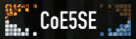
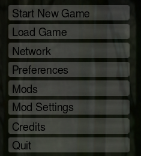
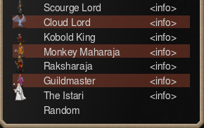
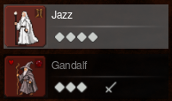
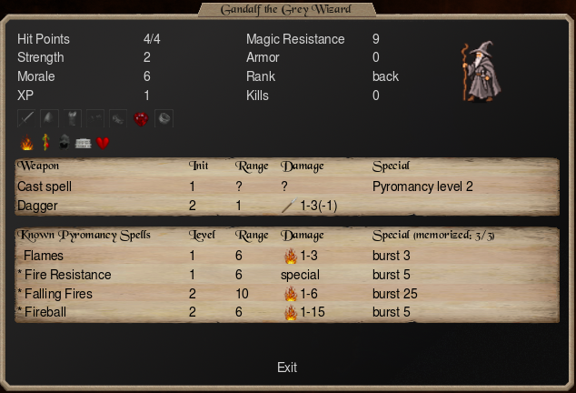
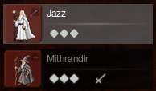
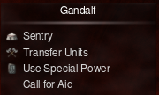
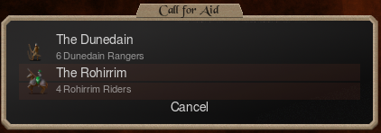

# Getting Started

A CoE5SE mod starts as a standard vanilla mod folder containing a `.c5m` file. You can add CoE5SE commands directly inside the `.c5m` with `#!@` lines, place them in an optional `.c5se` file, and add an optional `.lua` script. When included, the `.c5se` and `.lua` files must share the exact same base filename as your `.c5m` (for example, `Istari.c5m`, `Istari.c5se`, and `Istari.lua`).

## CoE5SE on the main menu { #main-menu }

Install CoE5SE from [GitHub](https://github.com/musical-pianist/coe5se#install) or [Nexus Mods](https://www.nexusmods.com/conquestofelysium5/mods/1). Once it is running, the main menu displays the CoE5SE banner in the top right and adds **Mod Settings** after **Mods**.

<div class="coe5se-shots" markdown>
<figure markdown>

<figcaption>CoE5SE's banner</figcaption>
</figure>
<figure markdown>

<figcaption>Mod Settings</figcaption>
</figure>
</div>

## The Istari mod { #build }

The rest of this page walks through a working example mod and three ways to organize its files. Please note this mod was created as an example only, and is in poor taste.

<div class="mod-explorer" markdown>
<div class="mod-explorer__layouts">
<button class="mod-explorer__layout" data-layout="c5m" type="button">.c5m</button>
<button class="mod-explorer__layout" data-layout="c5se" type="button">.c5se</button>
<button class="mod-explorer__layout" data-layout="split" type="button">.c5m and .c5se</button>
</div>
<p class="mod-explorer__caption" data-layout="c5m">Everything lives in a single <code>.c5m</code>, with CoE5SE commands prefixed by <code>#!@</code>. This is a great fit for a mod that works in vanilla CoE5 and gains extra features when CoE5SE is installed.</p>
<p class="mod-explorer__caption" data-layout="c5se">The <code>.c5m</code> holds only the mod info (<code>icon</code> and <code>description</code>), while all units, classes, and CoE5SE commands live cleanly in the <code>.c5se</code> without <code>#!@</code> prefixes.</p>
<p class="mod-explorer__caption" data-layout="split">Vanilla content stays in the <code>.c5m</code>, while CoE5SE edits live in a sidecar <code>.c5se</code>. Here we pretend the modder does not want the mod running in stock CoE5 because they insist the wizard be named “Gandalf”. Adding <code>needs_script_extender</code> to the <code>.c5m</code> makes vanilla CoE5 stop with a Mod Error.</p>
<div class="mod-explorer__tree">
<span class="mod-explorer__folder">Istari/</span>
<div class="mod-explorer__files" data-layout="c5m">
<button class="mod-explorer__file" data-file="c5m-c5m" type="button">Istari.c5m</button>
<button class="mod-explorer__file" data-file="lua" type="button">Istari.lua</button>
<button class="mod-explorer__file" data-file="white" type="button">istar.tga</button>
<button class="mod-explorer__file" data-file="grey" type="button">greywizard.tga</button>
<button class="mod-explorer__file" data-file="banner" type="button">banner.png</button>
</div>
<div class="mod-explorer__files" data-layout="c5se">
<button class="mod-explorer__file" data-file="c5se-c5m" type="button">Istari.c5m</button>
<button class="mod-explorer__file" data-file="c5se-c5se" type="button">Istari.c5se</button>
<button class="mod-explorer__file" data-file="lua" type="button">Istari.lua</button>
<button class="mod-explorer__file" data-file="white" type="button">istar.tga</button>
<button class="mod-explorer__file" data-file="grey" type="button">greywizard.tga</button>
<button class="mod-explorer__file" data-file="banner" type="button">banner.png</button>
</div>
<div class="mod-explorer__files" data-layout="split">
<button class="mod-explorer__file" data-file="split-c5m" type="button">Istari.c5m</button>
<button class="mod-explorer__file" data-file="split-c5se" type="button">Istari.c5se</button>
<button class="mod-explorer__file" data-file="lua" type="button">Istari.lua</button>
<button class="mod-explorer__file" data-file="white" type="button">istar.tga</button>
<button class="mod-explorer__file" data-file="grey" type="button">greywizard.tga</button>
<button class="mod-explorer__file" data-file="banner" type="button">banner.png</button>
</div>
</div>
<div class="mod-explorer__pane" data-file="c5m-c5m" markdown>

```c5m title="Istari/Istari.c5m"
icon "banner.png"
description "Adds The Istari, a class of wizards with Gandalf among them."

newmonster "Istar"
copystats "White Wizard"
spr1 "istar.tga"

newmonster "Grey Wizard"
copystats "Pyromancer"
spr1 "greywizard.tga"
#!@fixedname "Gandalf" # (1)!

newmonster "Dunedain Ranger" # (2)!
copystats "Longbowman"

newmonster "Rohirrim Rider"
copystats "Knight"

newclass
setclassname "The Istari"
classdescr "The Istari, wizards sent across the sea to stand against the Shadow."
hometerr 156 # (3)!
setmaincom "Istar" # (4)!
addstartcom "Grey Wizard"
addstartunits "Spearman" 10
addstartunits "Archer" 5
stdtroops
```

1.  CoE5SE reads `#!@` lines while vanilla CoE5 ignores them as comments: [The .c5m and the .c5se](index.md#files).
2.  One of the two units `Istari.lua` spawns on Gandalf's square when he uses Call for Aid.
3.  Terrain 156 is the Crystal Palace, the class's home citadel.
4.  The main commander's sprite (`istar.tga`) also serves as the class icon on the Choose Class screen.

</div>
<div class="mod-explorer__pane" data-file="c5se-c5m" markdown>

```c5m title="Istari/Istari.c5m"
icon "banner.png" # (1)!
description "Adds The Istari, a class of wizards with Gandalf among them."
```

1.  Mod info commands (`icon`, `description`, `modprio`, and similar) are read only from the `.c5m`.

</div>
<div class="mod-explorer__pane" data-file="c5se-c5se" markdown>

```c5se title="Istari/Istari.c5se"
newmonster "Istar"
copystats "White Wizard"
spr1 "istar.tga"

newmonster "Grey Wizard"
copystats "Pyromancer"
spr1 "greywizard.tga"
fixedname "Gandalf"

newmonster "Dunedain Ranger"
copystats "Longbowman"

newmonster "Rohirrim Rider"
copystats "Knight"

newclass
setclassname "The Istari"
classdescr "The Istari, wizards sent across the sea to stand against the Shadow."
hometerr 156
setmaincom "Istar"
addstartcom "Grey Wizard"
addstartunits "Spearman" 10
addstartunits "Archer" 5
stdtroops
```

</div>
<div class="mod-explorer__pane" data-file="split-c5m" markdown>

```c5m title="Istari/Istari.c5m"
icon "banner.png"
description "Adds The Istari, a class of wizards with Gandalf among them."
needs_script_extender

newmonster "Istar"
copystats "White Wizard"
spr1 "istar.tga"

newmonster "Grey Wizard"
copystats "Pyromancer"
spr1 "greywizard.tga"

newmonster "Dunedain Ranger"
copystats "Longbowman"

newmonster "Rohirrim Rider"
copystats "Knight"

newclass
setclassname "The Istari"
classdescr "The Istari, wizards sent across the sea to stand against the Shadow."
hometerr 156
setmaincom "Istar"
addstartcom "Grey Wizard"
addstartunits "Spearman" 10
addstartunits "Archer" 5
stdtroops
```

</div>
<div class="mod-explorer__pane" data-file="split-c5se" markdown>

```c5se title="Istari/Istari.c5se"
selectmonster "Grey Wizard" # (1)!
fixedname "Gandalf"
```

1.  CoE5SE loads the `.c5se` after the `.c5m`, so it can select monsters and classes defined in the `.c5m`.

</div>
<div class="mod-explorer__pane" data-file="lua" markdown>

```lua title="Istari/Istari.lua"
-- Once a game, Gandalf calls for aid, and the player picks who answers.
local ANSWERS = {
  {monster = "Dunedain Ranger", count = 6, label = "The Dunedain", line2 = "6 Dunedain Rangers"},
  {monster = "Rohirrim Rider", count = 4, label = "The Rohirrim", line2 = "4 Rohirrim Riders"},
}
local CANCEL = 9

-- The selected commander's unit, when it is a Grey Wizard.
local function selectedGreyWizard()
  local unit = coe5.get("commanderUnit", coe5.get("selectedCommander"))
  if unit >= 0 and coe5.get("unitMonster", unit) == coe5.findMonster("Grey Wizard") then return unit end
end

coe5.addCommanderLine{ -- (1)!
  label = "Call for Aid",
  tooltip = "Once per game. Dunedain Rangers or Rohirrim Riders join Gandalf.",
  visible = function() -- (2)!
    local unit = selectedGreyWizard()
    return unit ~= nil and not coe5.playerData[coe5.get("unitOwner", unit)].calledForAid
  end,
  onClick = function()
    local gandalf = selectedGreyWizard()
    local owner = coe5.get("unitOwner", gandalf)
    while true do
      coe5.ui.screenBegin("Call for Aid")
      for i, answer in ipairs(ANSWERS) do
        coe5.ui.monsterRow(i, coe5.findMonster(answer.monster), answer.label, answer.line2) -- (3)!
      end
      coe5.ui.buttonRow()
      coe5.ui.text(CANCEL, "Cancel")
      coe5.ui.bindEscape(CANCEL)
      local id = coe5.ui.wait() -- (4)!
      if id == CANCEL then return end
      local answer = ANSWERS[id]
      if answer then
        local x, y = coe5.get("unitX", gandalf), coe5.get("unitY", gandalf)
        for _ = 1, answer.count do
          coe5.spawnUnit(owner, coe5.monsterVariant(coe5.findMonster(answer.monster)), x, y) -- (5)!
        end
        coe5.playerData[owner].calledForAid = true
        return
      end
    end
  end,
}
```

1.  Adds a custom order to the selected commander's orders on the map.
2.  Shows the order only while a Grey Wizard is selected and that player has not called for aid yet. Values stored in `coe5.playerData` persist in the save file.
3.  Draws a choice row with the monster's sprite, matching the Recruit screen style.
4.  Displays the screen and waits for the player to select an option, returning that button's ID.
5.  `monsterVariant` picks one of the consecutive monster records sharing the same name, just like recruiting does.

</div>
<div class="mod-explorer__pane" data-file="white" markdown>


</div>
<div class="mod-explorer__pane" data-file="grey" markdown>


</div>
<div class="mod-explorer__pane" data-file="banner" markdown>


</div>
</div>

## The class { #class }

The Istari class and its units are built with standard vanilla commands from Illwinter's ["Monster Modding"](https://www.illwinter.com/coe5/coe5modding.pdf#page=14) and ["Class Modding"](https://www.illwinter.com/coe5/coe5modding.pdf#page=27) sections.

<div class="coe5se-shots" markdown>
<figure markdown>

<figcaption>The Istari, with the Istar's sprite</figcaption>
</figure>
</div>

## The CoE5SE command { #first-line }

The mod's single CoE5SE command, [`fixedname`](commands/commander-names.md#fixedname), forces every Grey Wizard to be named Gandalf.

<div class="coe5se-shots" markdown>
<figure markdown>

<figcaption>Gandalf in the commander list</figcaption>
</figure>
<figure markdown>

<figcaption>Gandalf the Grey Wizard on the commander stats screen</figcaption>
</figure>
</div>

Edits to `.c5m` and `.c5se` files do not require restarting CoE5. Change `fixedname "Gandalf"` to `fixedname "Mithrandir"`, open **Mods** then **Exit** on the main menu to reload mod content, and start a New World. (Lua script edits still require a restart.)

<div class="coe5se-shots" markdown>
<figure markdown>

<figcaption>Renamed to Mithrandir after Mods, Exit, and New World (no restart)</figcaption>
</figure>
</div>

## The Lua script { #lua }

Lua lets you add behavior that mod commands cannot, such as custom commander orders and screens. Here, `Istari.lua` gives Gandalf a once-per-game **Call for Aid** order. Choosing it opens a custom screen where the player picks either the Dunedain or the Rohirrim, spawning them on Gandalf's square.

<div class="coe5se-shots" markdown>
<figure markdown>

<figcaption>Call for Aid among Gandalf's orders</figcaption>
</figure>
<figure markdown>

<figcaption>The player chooses which reinforcements spawn on Gandalf's square</figcaption>
</figure>
</div>

This ends the sample. The rest is up to you!

## Where to go next { #next }

- [Commands](commands/index.md): every mod command CoE5SE adds to `.c5m` and `.c5se` files.
- [Spells](commands/spells.md): custom combat spells.
- [Spell Paths](commands/spell-paths.md): custom magic paths, and referencing paths by name.
- [Planes](commands/planes.md): custom planes, set pieces, and referencing planes by name.
- [Factions](commands/factions.md): custom independent factions.
- [Event Logic](commands/events.md): `if`, `elseif`, `else`, and `or` branching for events.
- [Mod Settings](commands/mod-settings.md): player-configurable settings for events and Lua scripts.
- [Lua](lua/index.md): scripting setup, mod types, hooks, state, UI, custom commands, and LAN games.
- [Limits](commands/limits.md): CoE5SE's limits and caps compared to vanilla.
