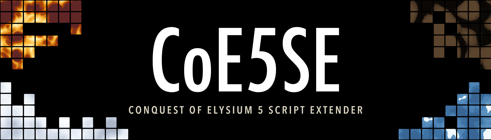

# CoE5SE

CoE5SE is the script extender for Conquest of Elysium 5. It raises the game's limits, and lets modders call other aspects of the game never before possible. Custom Planes? Smarter AI? New and unique UI? All are possible with CoE5SE. Built for Windows and Mac.

This is the documentation site for modders building on CoE5SE, and for anyone curious about what a mod can do with it. It is not for anyone looking to understand how the vanilla game works, or to troubleshoot regular in-game errors.

To get started, please consider the following pages below:

- [Commands](commands/index.md): every mod command CoE5SE adds to .c5m and .c5se files.
- [Limits](commands/limits.md): CoE5SE's limits compared to vanilla.
- Lua: coming soon. For now, see [`coe5.lua`](https://github.com/musical-pianist/coe5se/blob/main/coe5.lua) on GitHub.

If something here is wrong or missing, open an issue on [GitHub](https://github.com/musical-pianist/coe5se-docs/issues).
