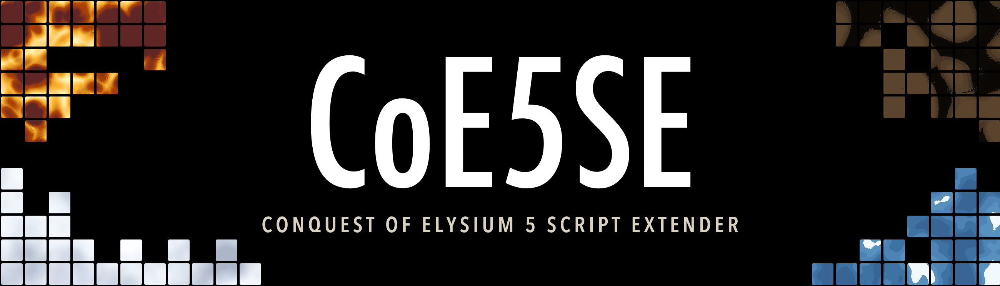

# CoE5SE



CoE5SE is the script extender for Conquest of Elysium 5. It raises the game's limits, and lets modders call other aspects of the game never before possible. Custom Planes? Smarter AI? New and unique UI? All are possible with CoE5SE. Built for Windows and Mac.

This is the documentation site for modders building on CoE5SE, and for anyone curious about what a mod can do with it. It is not for anyone looking to understand how the vanilla game works, or to troubleshoot regular in-game errors.

## The .c5m and the .c5se { #files }

Put CoE5SE's commands in your mod's .c5m, each line starting with `#!@`. The vanilla game skips those lines, so your mod still loads without them.

Or put them in a .c5se: a file next to your .c5m, with the same name, its lines written without `#!@`. CoE5SE reads it right after the .c5m, and the vanilla game never opens it.

Every example on this site has a .c5m tab and a .c5se tab, and the one you pick shows on every page. The few commands that work in one file only say so.

=== ".c5m"

    ```c5m
    #!@newspellpath "Lore of the Istari"
    ```

=== ".c5se"

    ```c5se
    newspellpath "Lore of the Istari"
    ```

## Where to start { #start }

To get started, please consider the following pages below:

- [Getting Started](getting-started.md): an example mod, shown in the game.
- [Commands](commands/index.md): every mod command CoE5SE adds to .c5m and .c5se files.
- [Limits](commands/limits.md): CoE5SE's limits compared to vanilla.
- [Lua](lua/index.md): what Lua scripts do in LAN games, and where every function is listed.

If something here is wrong or missing, open an issue on [GitHub](https://github.com/musical-pianist/coe5se-docs/issues).
