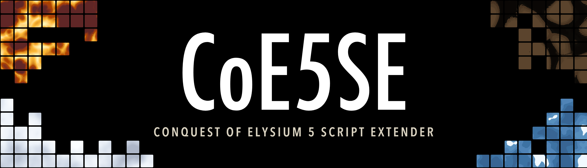

# CoE5SE



CoE5SE is the script extender for Conquest of Elysium 5. It raises the game's limits and lets modders reach parts of the game never before possible. Custom Planes? Smarter AI? New and unique UI? All are possible with CoE5SE. Built for Windows and Mac.

This is the documentation site for modders building on CoE5SE, and for anyone curious about what a mod can do with it. It is not for learning vanilla CoE5 mechanics or troubleshooting regular in-game errors.

## The .c5m and the .c5se { #files }

You can write CoE5SE mod commands in two ways:

- **Inside your `.c5m`:** Prefix each CoE5SE line with `#!@`. Vanilla CoE5 skips `#!@` lines as comments, so the mod can still load without CoE5SE.
- **In a `.c5se` file:** Place a `.c5se` file next to your `.c5m` with the same base filename (for example, `Istari.c5m` and `Istari.c5se`) and write commands without `#!@`. CoE5SE reads the `.c5se` right after the `.c5m`, and vanilla CoE5 never opens it.

You can use either layout or mix both. Vanilla mod openers (`icon`, `description`, `modprio`) along with `requires` and `needs_script_extender` go in the `.c5m`.

Most command examples on this site have both `.c5m` and `.c5se` tabs, and the tab you pick persists across pages. Commands restricted to one file say so.

=== ".c5m"

    ```c5m
    #!@newspellpath "Lore of the Istari"
    ```

=== ".c5se"

    ```c5se
    newspellpath "Lore of the Istari"
    ```

## Where to start { #start }

- [Getting Started](getting-started.md): installing CoE5SE and walking through an example mod, from file layouts to Lua.
- [Commands](commands/index.md): every mod command CoE5SE adds to `.c5m` and `.c5se` files.
- [Limits](commands/limits.md): CoE5SE's limits compared to vanilla.
- [Lua](lua/index.md): scripting setup, mod types, hooks, state, UI, custom commands, and LAN games.
- [What's New](whats-new.md): commands and pages added in recent releases.

If something here is wrong or missing, open an issue on [GitHub](https://github.com/musical-pianist/coe5se-docs/issues).
