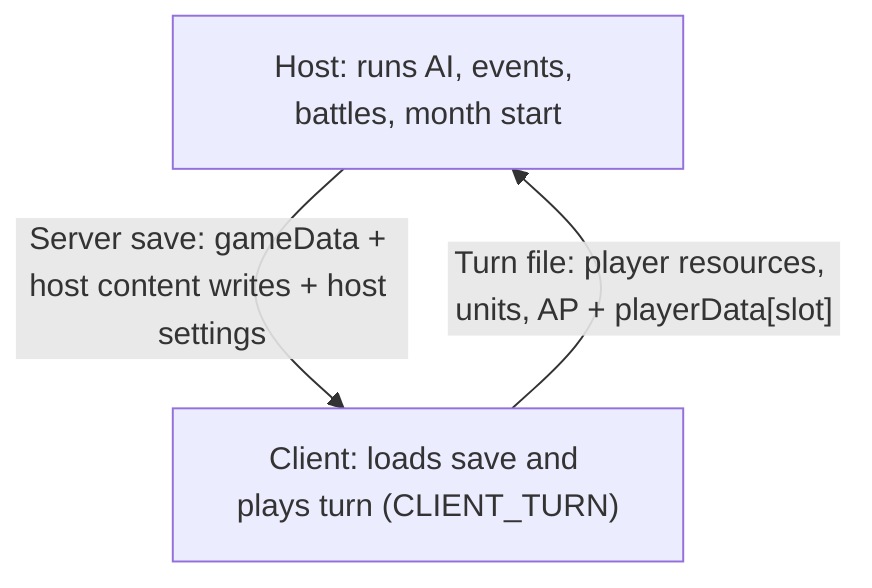

# LAN Games

[`coe5.lua`](https://github.com/musical-pianist/coe5se/blob/main/coe5.lua) documents every site and [`coe5_calls.lua`](https://github.com/musical-pianist/coe5se/blob/main/coe5_calls.lua) every call. This page covers how scripts behave in a LAN game, which sites personal mods can reach, and the multiplayer gotchas.

| Mod type | Declare in `.c5se` or `#!@` | Script runs on | Every player needs it |
| --- | --- | --- | --- |
| **Content** | *(nothing)* | Host and every client | Yes (identical files) |
| **Personal** | [`personalmod`](../commands/mod-loading.md#personalmod) | Its player's client, and a host that has it | No |
| **No multiplayer** | [`nomultiplayer`](../commands/mod-loading.md#nomultiplayer) | Nowhere | No |

Single player and hotseat are unchanged. Lua never runs in official multiplayer on Illwinter servers. Mac site coverage lags behind Windows, so some sites are missing on Mac builds (always progressing). Use `coe5.netRole()` (`coe5.net.single`, `coe5.net.host`, `coe5.net.client`) to check which machine your script is running on. Use `coe5.localPlayer()` for the active local player slot (`nil` on a host or while a client waits for a turn).



## Content mods

### Execution and state

<!-- vale CoE5SE.Reports = NO -->
- **Where hooks run:** The host runs hooks for events, the AI, battles, and month processing. Clients run hooks during their player's turn and during battle replays.
- **Keep match state in `gameData` and `playerData`:** Lua globals are not saved and can leak stale values across games. They also reset when CoE5SE rebuilds a script's state (on LAN start, join, leave, error restarts, or Rehearse LAN games). Store shared state in `coe5.gameData` (host to every client) and per-player state in `coe5.playerData[slot]` (client to host for that slot; writes to other slots stay local).
- **No top-level writes to `gameData` or `playerData`:** Top-level writes while a script loads are refused and undone (`during_load`). Initialize defaults in `GAME_START` or on first read.
- **No local INI reads:** `coe5.readIni` and `coe5.listIni` are refused on both host and clients in LAN games (`lan_local_data`) so local files cannot desync the match.
<!-- vale CoE5SE.Reports = YES -->

### Client writes and host requests

<!-- vale CoE5SE.Reports = NO -->
A client can write only state that reaches the host: the active player's resources, AI level, trade type, units' action points, and travelling player calls (`spawnUnit`, `spawnCommander`, and similar). Travelling square calls also work (`alterTerrain`, `digTunnelSquare`, `ruinSquare`, `teleportSquare`, `revealDisc`, `removeEnchant`, `destroyGateway`, `swapLocations`).

Writes to other players, event variables, game settings, non-travelling square calls (`setSquareOwner`, `cleanSquare`, `swapSquares`, `killSquare`), and `coe5.set` on square values fail (`not_own_player`, `client_write_lost`, or `client_not_acting` while waiting for a turn).
<!-- vale CoE5SE.Reports = YES -->

To ask the host to run a host-only change, write a request into `coe5.playerData[slot]` during the client's turn and handle it on the host:

```lua
-- Client: Gondor's player calls for aid as the turn ends
local function callForAid(_, player)
  coe5.playerData[player].lightBeacons = true
end
coe5.observe("CLIENT_TURN", nil, callForAid)
coe5.observe("HUMAN_TURN", nil, callForAid)   -- single player and hotseat

-- Host: answer at the month's start
coe5.observe("MONTH_START", nil, function()
  for slot = 0, 47 do
    if coe5.playerData[slot].lightBeacons then
      coe5.playerData[slot].lightBeacons = nil
      coe5.set("eventVar", 7900, 1)   -- +varequal 7900 1 in your .c5m sends the Rohirrim
    end
  end
end)
```

### Content record writes

<!-- vale CoE5SE.Reports = NO -->
- Host calls to `coe5.set` on content records (`monster`, `weapon`, `item`, `class`, `terrain`, `ritual`) travel to every client inside each turn's server save and replace the previous turn's play-time writes on load.
- Clients cannot modify content records during play (`client_write_lost`), except while mods are read (`MODS_READ` and script load), where every machine executes the same edits identically.
<!-- vale CoE5SE.Reports = YES -->

### Battle replays and determinism

<!-- vale CoE5SE.Reports = NO -->
Content scripts run during client battle replays so combat hooks produce the same outcome on every machine:

- Inside battle-round wraps and observers (not drawing or screen sites), `math.random` draws from a deterministic stream seeded by the battle and mod name (`math.randomseed` is ignored). `pairs` and `next` iterate keys in deterministic sorted order.
- `coe5.gameData` and `coe5.playerData` snapshot before a fight, restore to that snapshot during its replay, and switch back afterward.
- Writes that would leak out of a replay are refused (`replay`).
- If a replay finishes with a different outcome while a script ran in battle code, CoE5SE shows `"CoE5SE: Replay differs"` once per launch on the next map frame. This applies to content scripts in LAN and to any script in single player.
<!-- vale CoE5SE.Reports = YES -->

### UI, errors, and single-player rehearsal

<!-- vale CoE5SE.Reports = NO -->
- **No UI on the host:** No player sits at the host process, so UI calls and `showMessageBox` fail there (`lan_host`). Put UI in a personal mod.
- **Error recovery:** A content script that stops with an error restarts on the next turn, and every player is notified.
- **Test with one machine:** Turn on **Rehearse LAN games in single player** in CoE5SE's Mod Settings. It restarts content scripts at each human turn and enforces client write rules locally.
<!-- vale CoE5SE.Reports = YES -->

## Personal mods

Personal mods are for client-side UI, overlays, and hotkeys that each player enables independently. Keep gameplay content (monsters, spells, events) out of a personal mod, because adding gameplay content turns it into a content mod even with `personalmod`.

<!-- vale CoE5SE.Reports = NO -->
- **Capabilities:** Can perform any action its player can perform in-game, End Turn included. Calls a player cannot trigger in-game (such as adding gold, spawning units, or `coe5.revealMap`) return `nil`.
- **Fog filtering:** Reads and observers are filtered to the player's sight. Fogged units, armies, and squares return `nil`, lists skip unseen entries, and observers skip calls involving unseen units, commanders, or squares. Battle replays on screen and the Game Over screen lift the fog.
- **Turn hook:** `HUMAN_TURN` never fires in a LAN game. Use `CLIENT_TURN` (and `HUMAN_TURN` if you also support single player and hotseat).
- **Wait screen and errors:** UI calls fail while waiting for a turn (`wait_screen`). A personal script that errors stays off without notifying other players.
- **On a host:** If the host has the personal mod enabled, it runs for the host's screens only. Message boxes and game state writes fail there.
- **Visibility:** Players see each other's enabled personal mods on **Setup Participants** and in the `"CoE5SE: Mods with scripts"` join notice.
<!-- vale CoE5SE.Reports = YES -->

??? info "Sites a personal mod can wrap (30)"
    `ARMY_WAIT`, `BATTLE_DRAW`, `BATTLE_WAIT`, `CEREMONY_SCREEN_ROW`, `CEREMONY_SCREEN_WAIT`, `FILE_BROWSER_HOVERED`, `FILE_BROWSER_ROW_DATE`, `FILE_BROWSER_WAIT`, `GAME_MENU_SAVING_SECTION_END`, `GAME_MENU_WAIT`, `GAME_OVER_WAIT`, `KEYBOARD_SHORTCUTS_WAIT`, `MAP_DRAW`, `MAP_MENU_BUTTON_TEXT`, `MAP_SCREEN_WAIT`, `MESSAGES_WAIT`, `MESSAGE_BOX_WAIT`, `MOD_BANNER_DRAW`, `RECRUIT_WAIT`, `RITUAL_SCREEN_ROW`, `RITUAL_SCREEN_WAIT`, `SQUARE_INFO_BUTTON_ROW`, `SQUARE_INFO_SCREEN`, `SQUARE_INFO_WAIT`, `SQUARE_PANEL_WRAP`, `TOOLTIP_LINE_DRAW`, `TOP_BAR_INCOME`, `UNIT_LIST_WAIT`, `VIEW_ARMY_WAIT`, `WARN_WAIT`.

    Personal observers run on client-side observe-only sites (excluding `UNIT_CATCH_FIRE`, `APE_POSSESSION`, `RITUAL_COST_PERCENT`, and the 11 `PLAYER_*_INCOME` sites from `PLAYER_GOLD_INCOME` through `PLAYER_GEM_INCOME`) whenever the player can see the call's units, commanders, and squares.

## No multiplayer mods

Use [`nomultiplayer`](../commands/mod-loading.md#nomultiplayer) for single-player utilities like a restart button or game presets. The entire mod (scripts and content) is turned off during LAN games and restored afterward. A single-player save that uses a `nomultiplayer` mod's content, script planes, or script factions cannot be hosted (`"CoE5SE: Mod not for network games"`).

## Settings and keys

`coe5.setting` returns the host's pick in a content mod and the local player's pick in a personal mod. On a LAN client, only a personal mod can set or rebind keys.

## Mod files must match

If a content mod's `.c5m`, `.c5se`, or `.lua` files differ between machines, CoE5SE ends the game for everyone with `"CoE5SE: Mod files differ"`. In `.c5m` and `.c5se` files, `description`, comments, spacing, and settings blocks are ignored. Personal and `nomultiplayer` mods are not compared.

!!! warning "Ship .lua changes to every player at once"
    Each `.lua` file in your mod's folder is hashed whole, comments included, loaded or not. One player with an edited copy ends the game. One player who injects Lua not hashed immediately crashes the game.
